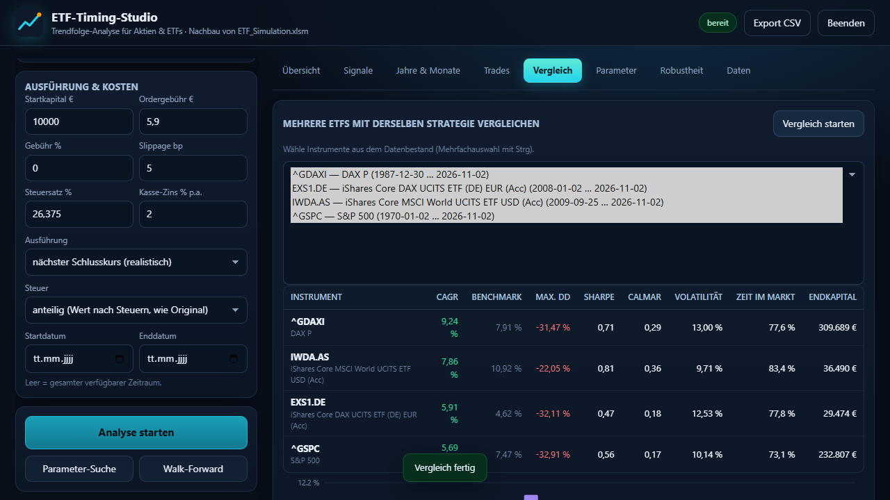

# Anleitung – ETF-Timing-Studio

**Ein Handbuch für die tägliche Arbeit mit dem Tool.**
Für die Projektübersicht siehe `README_ETF_Tool.md`, für die Analyse der
Original-Arbeitsmappe siehe `Analyse_ETF_Simulation_Original.md`.

---

## Inhalt

1. [Was das Tool für Sie tut](#1-was-das-tool-für-sie-tut)
2. [Voraussetzungen und Start](#2-voraussetzungen-und-start)
3. [In fünf Minuten zum ersten Ergebnis](#3-in-fünf-minuten-zum-ersten-ergebnis)
4. [Die Oberfläche verstehen](#4-die-oberfläche-verstehen)
5. [Instrumente auswählen](#5-instrumente-auswählen)
6. [Signaltypen und ihre Parameter](#6-signaltypen-und-ihre-parameter)
7. [Ausführung, Kosten und Steuer](#7-ausführung-kosten-und-steuer)
8. [Die acht Reiter im Detail](#8-die-acht-reiter-im-detail)
9. [Ergebnisse sichern und weiterverwenden](#9-ergebnisse-sichern-und-weiterverwenden)
10. [Vier typische Arbeitsabläufe](#10-vier-typische-arbeitsabläufe)
11. [Daten verwalten](#11-daten-verwalten)
12. [Kennzahlen von A bis Z](#12-kennzahlen-von-a-bis-z)
13. [Kommandozeile](#13-kommandozeile)
14. [Wenn etwas nicht funktioniert](#14-wenn-etwas-nicht-funktioniert)
15. [Grenzen und verantwortungsvoller Umgang](#15-grenzen-und-verantwortungsvoller-umgang)
16. [Anhang](#16-anhang)

---

## 1. Was das Tool für Sie tut

Das ETF-Timing-Studio simuliert eine **Trendfolge-Regel** über historische Kurse
und beantwortet drei Fragen:

1. **Wann** wäre man investiert gewesen – und wann in Kasse?
2. **Was** hätte das gebracht (Rendite, Verlust, Schwankung) – nach Gebühren
   und Steuer?
3. **Wie belastbar** ist das Ergebnis – über verschiedene Zeiträume, Parameter
   und Kostenannahmen?

Es ist ein **Analysewerkzeug**, keine Handelssoftware und keine Anlageberatung.
Es sagt Ihnen nicht, was Sie morgen kaufen sollen, sondern was eine Regel in der
Vergangenheit geleistet hätte – ehrlich gerechnet, inklusive der unangenehmen
Ergebnisse.

---

## 2. Voraussetzungen und Start

### 2.1 Was Sie brauchen

| Voraussetzung | Details |
|---|---|
| Betriebssystem | Windows 10/11, macOS oder Linux |
| Python | **3.8 oder neuer**, keine Zusatzpakete nötig |
| Browser | Chrome, Edge, Firefox oder Safari (aktuell) |
| Internet | nur zum Laden von Kursen (CSV-Import geht offline) |

### 2.2 Start unter Windows

1. Den Ordner mit `ETF_Tool.py` öffnen.
2. **Doppelklick auf `Start_ETF_Tool.bat`.**
3. Es öffnet sich ein schwarzes Fenster (die Konsole) und kurz darauf der
   Browser mit der Oberfläche.

Beim ersten Mal kann Windows SmartScreen eine Warnung anzeigen – das ist bei
heruntergeladenen `.bat`-Dateien normal. Über „Weitere Informationen“ →
„Trotzdem ausführen“ starten.

### 2.3 Start unter macOS / Linux

```bash
python3 ETF_Tool.py
```

### 2.4 Was beim Start passiert

In der Konsole erscheint:

```
==========================================================================
  ETF-Timing-Studio 1.0
==========================================================================
  Oberfläche:  http://127.0.0.1:8765/
  Datenordner: …/data
  Beenden:     Strg+C im Fenster oder Button 'Beenden'
==========================================================================
```

* Der Server läuft **nur auf Ihrem Rechner** (`127.0.0.1`), nicht im Netzwerk.
* Ist Port 8765 belegt, wird automatisch ein freier Port gewählt – die
  tatsächliche Adresse steht immer in der Konsole.
* Der Browser öffnet sich selbst. Falls nicht: Adresse aus der Konsole
  kopieren und einfügen.

### 2.5 Beenden

| Weg | Wirkung |
|---|---|
| Button **„Beenden"** oben rechts | Server fährt herunter (nach Sicherheitsabfrage) |
| **Strg+C** in der Konsole | sofortiges Beenden |
| Browser-Tab schließen | **beendet den Server nicht** – er läuft weiter |

Wenn Sie den Rechner herunterfahren, endet der Prozess ohnehin. Es werden keine
Dienste installiert, nichts startet automatisch mit.

### 2.6 Die Ordnerstruktur

```
ETF_Tool.py                     das Programm (die einzige nötige Datei)
Start_ETF_Tool.bat              Windows-Starter
README_ETF_Tool.md              Projektübersicht
Anleitung.md                    diese Anleitung
Analyse_ETF_Simulation_Original.md   Reverse-Engineering der Excel-Datei
data/
  index.json                    Verzeichnis der geladenen Instrumente
  cache/<SYMBOL>.json           Kursreihen (Datum, Schluss, adjustiert)
screenshots/                    Bilder für die Dokumentation
tool_src/                       Quellteile (nur für Entwicklung)
```

`data/` wird beim ersten Download automatisch angelegt. Sie dürfen den Ordner
jederzeit löschen – das Tool startet dann „leer“ und lädt neu.

---

## 3. In fünf Minuten zum ersten Ergebnis

1. **Starten** (siehe 2.2). Beim allerersten Start sind keine Kurse vorhanden;
   in der Übersicht erscheint eine Willkommenskarte.
2. **„Standard-Daten laden“** klicken. Es werden drei Reihen geladen
   (`IWDA.AS` MSCI World, `^GSPC` S&P 500, `EXS1.DE` DAX-ETF) – das dauert
   wenige Sekunden.
3. Die Analyse läuft automatisch an. Oben rechts wechselt die Statuspille von
   „lade Kurse …“ zu **„bereit“**, unten erscheint kurz eine grüne Meldung.
4. Sie sehen neun Kennzahlenkarten und den **Vermögensverlauf**.
5. Klicken Sie die Reiter durch: **Signale**, **Jahre & Monate**, **Trades**.
6. Zum Schluss **„Walk-Forward“** in der linken Spalte drücken und 10–30 Sekunden
   warten – das ist die ehrlichste Zahl im ganzen Tool.

> **Merksatz:** Erst Daten, dann Vorlage, dann „Analyse starten“ – und immer
> den Vergleich mit Buy & Hold im Blick behalten.

---

## 4. Die Oberfläche verstehen

```
┌──────────────────────────────────────────────────────────────────────────┐
│  Logo   ETF-Timing-Studio                  [Status] [Export CSV] [Beenden]│
├───────────────────────┬──────────────────────────────────────────────────┤
│ STEUERUNG (links)     │  ARBEITSBEREICH (rechts)                         │
│                       │  ┌────────────────────────────────────────────┐  │
│ Strategie-Vorlage     │  │ Übersicht Signale Jahre Trades Vergleich … │  │
│ Instrumente           │  ├────────────────────────────────────────────┤  │
│ Signal                │  │ Kennzahlenkarten                           │  │
│ Ausführung & Kosten   │  │ Diagramme                                  │  │
│ [Analyse starten]     │  │ Tabellen                                   │  │
│ [Parameter] [Walk-Fw] │  └────────────────────────────────────────────┘  │
└───────────────────────┴──────────────────────────────────────────────────┘
```

### 4.1 Die linke Spalte (Steuerung)

Sie ist beim Scrollen fixiert und in vier Blöcke geteilt:

| Block | Inhalt |
|---|---|
| **Strategie-Vorlage** | sieben fertige Konfigurationen; Auswahl füllt alle Felder |
| **Instrumente** | Risiko-Anlage, Signalgeber, Defensiv-Anlage |
| **Signal** | Signaltyp und dessen Parameter |
| **Ausführung & Kosten** | Kapital, Gebühren, Slippage, Steuer, Zins, Zeitraum |
| **Aktionen** | „Analyse starten“, „Parameter-Suche“, „Walk-Forward“ |

### 4.2 Die Statuspille (oben rechts)

| Anzeige | Bedeutung |
|---|---|
| **bereit** (grün) | Server verbunden, nichts zu tun |
| **verbinde …** | Startphase |
| **busy / rechne …** (blau) | eine Berechnung läuft (mit Fortschritts-Overlay) |
| **keine Daten** (gelb) | noch keine Kursreihen vorhanden |
| **Fehler** (rot) | letzter Vorgang fehlgeschlagen – Meldung unten lesen |
| **beendet** (gelb) | Server wurde heruntergefahren |

### 4.3 Meldungen

Unten in der Mitte erscheint für ~4 Sekunden eine Meldung:

* **grün** = erfolgreich („Fertig: 7,86 % p. a. · max. Verlust −22,05 %“)
* **rot** = Fehler („Backtest fehlgeschlagen: …“)

Bei längeren Rechnungen legt sich ein halbtransparentes Overlay mit Spinner über
die Seite. Warten Sie, bis es verschwindet – währenddessen ist die Oberfläche
gesperrt.

### 4.4 Die Reiter

| Reiter | Kurzbeschreibung |
|---|---|
| **Übersicht** | Kennzahlen, Vermögensverlauf, Drawdown, Kennzahlentabelle |
| **Signale** | Kurs vs. Durchschnitt, RSL mit Schwellen, aktueller Zustand |
| **Jahre & Monate** | Jahresbalken, Monats-Heatmap, Jahresübersicht |
| **Trades** | jede Umschichtung mit Kosten und Gewinn |
| **Vergleich** | dieselbe Regel auf mehreren ETFs |
| **Parameter** | Parametersuche mit Heatmap und Rangliste |
| **Robustheit** | Walk-Forward, Monte-Carlo, Kosten-Sensitivität |
| **Daten** | Kursbestand, Yahoo-Download, CSV-Import |

Die Reiter merken sich ihren Zustand: Wenn Sie die Analyse neu starten,
aktualisieren sich alle bereits berechneten Ansichten.

---

## 5. Instrumente auswählen

Drei Rollen sind zu besetzen:

| Feld | Rolle | Beispiel |
|---|---|---|
| **Risiko-Anlage** | Was wird gehalten, wenn das Signal „grün“ ist? | `IWDA.AS` (MSCI World) |
| **Signalgeber** | Welcher Index erzeugt das Signal? | `^GSPC` (S&P 500) |
| **Defensiv-Anlage** | Was wird bei „rot“ gehalten? | Kasse (Standard) oder ein Anleihen-ETF |

### 5.1 Symbole finden

Neben jedem Feld steht eine **Lupe**. Klicken → Suchdialog → Begriff eingeben
(z. B. „MSCI World“, „DAX“, „Anleihen“) → **auf einen Treffer klicken**.
Das Symbol wird übernommen und die Daten werden sofort geladen.

Alternativ tippen Sie das Symbol direkt ein; das Eingabefeld schlägt bereits
geladene Instrumente vor.

### 5.2 Sinnvolle Kombinationen

| Ziel | Risiko | Signal | Defensiv |
|---|---|---|---|
| Klassiker, breit gestreut | `IWDA.AS` | `^GSPC` oder `IWDA.AS` | Kasse |
| Länderwette Deutschland | `EXS1.DE` | `^GDAXI` | Kasse |
| Sehr lange Historie (Krisentest) | `^GSPC` | `^GSPC` | Kasse |
| Mit Anleihen-Puffer | `IWDA.AS` | `^GSPC` | `IUAG.L` |
| Gold als Beimischung | `4GLD.DE` | `^GSPC` | Kasse |

### 5.3 Drei Regeln, die Sie kennen sollten

1. **Signalgeber ≠ Risiko-Anlage ist ausdrücklich erlaubt** und oft sinnvoll:
   Ein weltweiter ETF auf ein US-Signal (S&P 500) reagiert früher als auf sein
   eigenes, trägeres Signal.
2. **Signal = Risiko-Anlage** (gleiche Zeile eintragen) ist die einfachste
   Variante und vermeidet Verzögerungen durch unterschiedliche Handelstage.
3. **Defensiv-ETF nur mit Bedacht:** Ein Anleihen-ETF kann selbst fallen. Die
   Kasse (mit einstellbarem Zins) ist die konservativere Referenz.

> **Tipp:** Wenn ein Feld leer bleibt oder das Symbol unbekannt ist, bricht der
> Lauf mit einer roten Meldung ab. Prüfen Sie dann die Schreibweise – ETFs
> brauchen das Börsenkürzel (`IWDA.AS`, nicht `IWDA`).

---

## 6. Signaltypen und ihre Parameter

Die Auswahl **„Signaltyp“** bestimmt, welche Regel aus dem Signalgeber ein
An/Aus macht. Nicht benötigte Parameter werden ausgeblendet.

### 6.1 RSL-Ampel (Original)

Die Regel aus der Original-Arbeitsmappe – mit Hysterese, damit nicht bei jedem
Zittern umgeschichtet wird.

| Parameter | Standard | Wirkung |
|---|---|---|
| **RSL-Tage** | 130 | Länge des gleitenden Durchschnitts. Kurz = nervös, lang = träge. Sinnvoll: 80–250 |
| **Obergrenze** | 1,05 | Ab hier sofort „grün“ (Kurs 5 % über Durchschnitt) |
| **Untergrenze** | 0,92 | Ab hier sofort „rot“ (8 % unter Durchschnitt) |
| **Wechseltage rot** | 19 | So viele Tage unter 1,0 in Folge → rot |
| **Wechseltage grün** | 16 | So viele Tage über 1,0 in Folge → grün |

**So wirkt es:** Die Schwellen sind die Notbremse (schnelle Reaktion bei
starken Bewegungen), die Wechseltage der Filter gegen Seitwärts-Gezappel.
Kleinere Obergrenze/größere Untergrenze = frühere, aber häufigere Wechsel.

### 6.2 SMA-Trend

| Parameter | Standard | Wirkung |
|---|---|---|
| **SMA-Tage** | 200 (Vorlage „200-Tage-SMA“) | Kurs über Durchschnitt → investiert |
| **Hysterese ±** | 0,00 | Pufferzone um 1,0 (z. B. 0,02 = erst bei +2 % rein, bei −2 % raus) |

Der bekannteste Filter („200-Tage-Linie“). Ohne Hysterese wechselt er bei
Seitwärtsmärkten häufig.

### 6.3 Golden Cross

| Parameter | Standard | Wirkung |
|---|---|---|
| **kurzer SMA** | 50 | schneller Durchschnitt |
| **langer SMA** | 200 | langsamer Durchschnitt |

Investiert, solange der kurze über dem langen liegt. Träger als der reine
Kurs/SMA-Vergleich, dafür weniger Fehlsignale.

### 6.4 Momentum

| Parameter | Standard | Wirkung |
|---|---|---|
| **Momentum-Tage** | 252 | investiert, wenn die Rendite der letzten N Tage positiv ist |

Ein Klassiker aus der Faktor-Forschung, sehr robust, aber spät bei Wendepunkten.

### 6.5 Was Sie beim Probieren sehen werden

* **Mehr Hysterese** → weniger Trades, weniger Gebühren, späteres Aussteigen.
* **Kürzere Durchschnitte** → früher raus, aber mehr Fehlsignale in Seitwärtsphasen.
* **Alle Varianten** liefern über lange Zeiträume meist **etwas weniger Rendite**
  als Buy & Hold, dafür **deutlich kleinere Drawdowns**. Das ist kein Fehler,
  sondern der eigentliche Zweck.

---

## 7. Ausführung, Kosten und Steuer

### 7.1 Kapital und Gebühren

| Feld | Standard | Hinweis |
|---|---|---|
| **Startkapital €** | 10.000 | frei wählbar; alle Beträge skalieren mit |
| **Ordergebühr €** | 5,90 | fix pro Order (Kauf *und* Verkauf) |
| **Gebühr %** | 0 | prozentualer Anteil, falls Ihr Broker so abrechnet |
| **Slippage bp** | 5 | 1 bp = 0,01 %. 5 bp = 0,05 % Auf-/Abschlag je Ausführung |

**Rechenbeispiel:** Bei 5,90 € fix und 20 Trades (10 Käufe + 10 Verkäufe)
entstehen 118 € Gebühren. Auf 10.000 € Startkapital ist das ~1,2 % – bei
häufigem Umschichten wird das zum Renditekiller. Deshalb zeigt die Übersicht
die Kosten separat an.

### 7.2 Steuer

| Feld | Standard | Bedeutung |
|---|---|---|
| **Steuersatz %** | 26,375 | Abgeltungssteuer + Soli (25 % × 1,055) |
| **Steuer-Modus** | anteilig | siehe unten |

Drei Modi:

| Modus | Was passiert | Wann sinnvoll |
|---|---|---|
| **anteilig** (Standard) | Täglich wird so gerechnet, als würden Sie jetzt verkaufen: Ordergebühr und fiktive Steuer auf den noch nicht realisierten Gewinn werden abgezogen. Entspricht der Original-Spalte „Wert nach Steuern“. | Konservativer Vergleich; so hat es das Original gemacht |
| **nur bei Verkauf** | Steuer fällt erst beim tatsächlichen Verkauf an; gehaltene Positionen werden brutto bewertet. | Wenn Sie echte Cashflows sehen wollen |
| **keine** | Ignoriert Steuer vollständig. | Vorsteuer-Vergleich, internationale Vergleiche |

Verluste werden im Modus „anteilig“/„nur bei Verkauf“ mit einem einfachen
Verlusttopf verrechnet (Option „Verlustverrechnung“ ist intern aktiv).

> **Wichtig:** Die ausgewiesenen „Steuern“ in der Kasse sind im Modus
> „anteilig“ eine **Rückstellung auf unrealisierte Gewinne**, kein tatsächlich
> gezahlter Betrag. Das erklärt, warum dort hohe Summen stehen können, obwohl
> wenige Trades stattfanden.

### 7.3 Kasse und Ausführung

| Feld | Standard | Bedeutung |
|---|---|---|
| **Kasse-Zins % p.a.** | 2,0 | Verzinsung des nicht investierten Kapitals (Tagesgeld/Short-Rate) |
| **Ausführung** | nächster Schlusskurs | siehe unten |

| Ausführung | Bedeutung | Empfehlung |
|---|---|---|
| **nächster Schlusskurs** | Signal vom Schlusskurs Tag T, gehandelt zum Schlusskurs Tag T+1 | **realistisch**, Standard |
| **gleicher Schlusskurs** | Signal und Handel am selben Schlusskurs | wie im Original – **optimistisch**, weil man den Schlusskurs erst danach kennt |

Der Unterschied kann über Jahrzehnte mehrere Prozentpunkte pro Jahr ausmachen.
Für ernsthafte Aussagen immer die realistische Variante verwenden.

### 7.4 Zeitraum

**Startdatum/Enddatum** leer lassen = gesamter verfügbarer Zeitraum (die
Schnittmenge aus Risiko- und Signalreihe). Für faire Vergleiche zwischen
Instrumenten denselben Zeitraum eintragen.

---

## 8. Die acht Reiter im Detail

### 8.1 Übersicht


**Zweck:** In zehn Sekunden erkennen, ob die Strategie etwas taugt.

**Neun Kennzahlenkarten** (von links nach rechts):

| Karte | Was sie zeigt | Worauf achten |
|---|---|---|
| Endkapital | Endwert nach Kosten und Steuer | mit Startkapital vergleichen |
| Gesamtrendite | Gesamtzuwachs in %, darunter Buy & Hold | Differenz zur Benchmark |
| CAGR p. a. | Jahresrendite, darunter Benchmark und Δ | **Δ negativ ist normal** |
| Max. Drawdown | größter Verlust vom Hoch, darunter Benchmark | **kleiner als Benchmark = Zweck erfüllt** |
| Sharpe | Rendite je Schwankung | > 0,5 ist ordentlich |
| Calmar | CAGR / max. Drawdown | **die wichtigste Kennzahl hier** |
| Volatilität | annualisierte Schwankung | Timing senkt sie meist |
| Zeit im Markt | Anteil der Tage mit ETF | niedrig = viel Kasse |
| Kosten & Steuer | Gebühren + (fiktive) Steuer | bei häufigen Trades kritisch |

**Vermögensverlauf:** cyan = Strategie, violett gestrichelt = Buy & Hold.
Die Checkbox **„logarithmisch“** ist bei langen Zeiträumen hilfreich, weil
prozentuale Veränderungen dann gleich groß aussehen. Unter dem Diagramm läuft
ein **Signalband**: grün = investiert, rot = Kasse.

**Drawdown:** Verlust vom jeweils letzten Hoch, in Prozent. Die gestrichelte
Linie ist Buy & Hold.

**Größte Verlustphasen:** die fünf tiefsten Einbrüche mit Zeitraum und Dauer.
Das ist die Liste, die man aushalten können muss.

**Kennzahlen im Vergleich:** alle Werte als Tabelle, Strategie vs. Buy & Hold.

### 8.2 Signale


**Zweck:** Prüfen, ob das Signal plausibel arbeitet.

* **Oberes Diagramm:** Kurs des Signalgebers (weiß) und gleitender Durchschnitt
  (gelb). Grüne Flächen = Risiko war aktiv, rote Flächen = Defensiv.
* **Unteres Diagramm:** der RSL-Wert mit gestrichelten Schwellen
  (Obergrenze grün, 1,0 grau, Untergrenze rot).
* **Aktueller Signalzustand:** vier Karten – Zustand (RISIKO AKTIV /
  DEFENSIV), Abstand zum Durchschnitt, Anteil der Risikophasen, Datum des
  letzten Wechsels.

**Typische Beobachtung:** In starken Trends bleibt das Signal lange grün, in
Seitwärtsphasen wechselt es mehrfach. Genau dort entstehen die Kosten.

### 8.3 Jahre & Monate


**Zweck:** Erkennen, *wann* die Strategie hilft und wann sie schadet.

* **Jahresrenditen:** Balkenpaare je Jahr (cyan Strategie, violett Buy & Hold).
  Die Legende zählt, in wie vielen Jahren die Strategie positiv war.
* **Monats-Heatmap:** Zeilen = Jahre, Spalten = Monate, Farbe = Rendite
  (grün positiv, rot negativ), letzte Spalte = Jahresergebnis.
  Hier sieht man Muster: Verlustmonate in Serie, Erholungsmonate, Seitwärtsjahre.
* **Jahresübersicht:** Tabelle mit Strategie, Benchmark, Differenz, Endstand –
  neueste Jahre oben.

**Lesart:** Eine Timing-Strategie „gewinnt“ meist in wenigen Krisenjahren und
„verliert“ in vielen Aufwärtsjahren leicht. Wenn die Heatmap in 2008 und 2000–02
deutlich besser aussieht als Buy & Hold, arbeitet sie wie gedacht.

### 8.4 Trades

**Zweck:** Jede Umschichtung nachvollziehen – und die Kosten sehen.

Oben sechs Kennzahlen: Anzahl Umschichtungen, Gewinnquote, durchschnittliche
Haltedauer, Summe Gebühren, Summe Steuern, bester Trade.

Die Tabelle zeigt je Order: Datum, Aktion (KAUF/VERKAUF), Instrument, Kurs,
Stück, Wert, Gebühr, Steuer, realisierter Gewinn. Über das Auswahlfeld lässt
sich auf Käufe oder Verkäufe filtern.

**Worauf achten:**

* Sehr kurze Haltedauern (< 20 Tage) sind ein Warnsignal für Zappeln.
* Viele kleine Verluste bei wenigen großen Gewinnen = typisches Trendfolge-Profil.
* Die Gewinnquote ist bei Trendfolge oft **niedrig** (30–45 %) – das ist normal,
  solange die Gewinne die Verluste überwiegen.

### 8.5 Vergleich



**Zweck:** Dieselbe Regel auf mehreren ETFs testen.

1. In der Liste (Mehrfachauswahl) Instrumente markieren – **Strg** (Windows)
   bzw. **Cmd** (Mac) gedrückt halten.
2. **„Vergleich starten“**.
3. Ergebnis: Tabelle sortiert nach CAGR, darunter ein Balkendiagramm
   (Strategie vs. Buy & Hold je Instrument).

Der Vergleich nutzt **alle aktuellen Einstellungen** (Signal, Kosten, Zeitraum),
nur die Risiko-Anlage wird ausgetauscht. Eine Monatsrotation wird dabei
automatisch deaktiviert.

**Wichtig:** Vergleichen Sie nur Instrumente mit ähnlichem Zeitraum. Ein ETF,
der erst 2019 aufgelegt wurde, hat naturgemäß eine andere Historie.

### 8.6 Parameter


**Zweck:** Herausfinden, ob die Strategie nur mit einer zufällig passenden
Parameterkombination funktioniert.

1. **„Parameter-Suche“** klicken (linke Spalte oder Reiter).
2. Das Tool rechnet je nach Signaltyp viele Kombinationen durch:
   * RSL-Ampel: 144 (6 RSL-Längen × 3 Obergrenzen × 4 Untergrenzen × 2 Wechseltag-Paare)
   * SMA-Trend: 18 · Golden Cross: 9 · Momentum: 5
3. Ergebnis:
   * **Beste Variante** (nach Calmar) als Merksatz,
   * **Heatmap** RSL-Tage × Obergrenze (Farbe = Calmar),
   * **Rangliste** mit allen Kennzahlen.
4. **„übernehmen“** in einer Zeile setzt die Parameter in die Steuerung –
   danach **„Analyse starten“** drücken, um die Variante vollständig zu sehen.

**So lesen Sie die Heatmap richtig:** Sie suchen keine einzelne grüne Zelle,
sondern **einen grünen Bereich**. Ist nur ein einziger Punkt gut, ist das ein
Artefakt (Überanpassung). Ist ein ganzes Feld ähnlich gut, ist die Regel stabil.

> Die Suche zeigt die beste **In-Sample**-Variante. Ob sie auch künftig gilt,
> sagt erst der Walk-Forward-Test im nächsten Reiter.

### 8.7 Robustheit


Drei Prüfungen, die aus einem „schönen“ Ergebnis ein belastbares machen:

**a) Walk-Forward** (Ziel wählbar: Calmar / CAGR / Sharpe)

* Ablauf: 6 Jahre Training → 2 Jahre Test, dann 2 Jahre weiterrollen.
  In jedem Trainingsfenster werden die Parameter neu gewählt und im *folgenden*
  Testfenster angewendet.
* Ergebnis: Out-of-Sample-CAGR, Anteil positiver Testfenster, verkettete
  OOS-Kurve, Tabelle der Fenster mit den jeweils gewählten Parametern.
* **Das ist die ehrlichste Zahl im Tool.** Liegt sie deutlich unter der
  In-Sample-Rendite, war die Optimierung Überanpassung.

**Was bedeuten Calmar, CAGR und Sharpe?**

Alle drei machen Rendite vergleichbar – sie bestrafen aber unterschiedlich viel
Risiko. Ausführliche Definitionen stehen in Kapitel 12.

| Ziel | Formel | Aussage | Verhalten bei der Optimierung |
|---|---|---|---|
| **CAGR** | (Endwert / Start)^(1 / Jahre) − 1 | durchschnittliche Jahresrendite (geometrisch) | wählt die ertragreichste Variante – auch wenn sie tiefe Einbrüche hat |
| **Calmar** | CAGR geteilt durch den Betrag des max. Drawdown | Ertrag je Verlustrisiko | wählt die am besten „durchhaltbare“ Variante; **Empfehlung für Timing-Strategien** |
| **Sharpe** | CAGR geteilt durch die Volatilität p. a. | Ertrag je Schwankung | wählt die glatteste Variante; bevorzugt Phasen mit viel Kasse (wenig Schwankung) |

Wichtig für die Interpretation:

* Das Ziel steuert **nur die Parameterauswahl im Trainingsfenster**. Die
  ausgewiesene OOS-Kurve und die OOS-Kennzahlen werden danach unabhängig davon
  gemessen – ein „geschöntes“ Ziel beeinflusst die Testzahlen also nicht.
* Unterschiedliche Ziele führen oft zu unterschiedlichen Parametersätzen.
  Schneidet **derselbe** Satz bei allen drei Zielen ähnlich gut ab, ist das ein
  starkes Zeichen für Robustheit.
* Die Sharpe-Ratio im Tool rechnet **ohne risikofreien Zins** (rf = 0). Bei viel
  Kasse wird die Volatilität sehr klein und Sharpe dadurch leicht „künstlich“
  gut – für Timing-Strategien ist Calmar die aussagekräftigere Wahl.
* Der Calmar hängt stark an **einem einzigen Extremwert**, dem größten
  Drawdown. Prüfen Sie deshalb zusätzlich die Liste „Größte Verlustphasen“ auf
  der Übersicht, bevor Sie eine Variante übernehmen.

**b) Monte-Carlo**

* 300 simulierte Zukünfte durch Zufallsauswahl historischer Tagesrenditen,
  10 Jahre Horizont.
* Ergebnis: 5 %-/50 %-/95 %-Quantil. Der Median zeigt das typische Ergebnis,
  die Spanne zeigt, wie breit die Unsicherheit ist.
* **Wichtig:** Das ist keine Prognose – es zeigt nur, welche Bandbreite aus dem
  bisherigen Verhalten folgt.

**c) Kosten-Sensitivität**

* Rechnet neun Szenarien: ohne Gebühren, ohne Slippage, ohne Steuer,
  Gebühr 15 €/30 €, Slippage 25/50 bp, Steuer 30 %.
* Zeigt, wie stark das Ergebnis an den Kostenannahmen hängt. Eine Strategie,
  die bei 30 € Gebühr zusammenbricht, ist für ein kleines Depot ungeeignet.
* Die Berechnung dauert einige Sekunden (neun vollständige Backtests).

### 8.8 Daten

**Zweck:** Kursbestand pflegen.

* **Datenbestand:** Tabelle aller geladenen Reihen mit Symbol, Name, Quelle,
  Zeitraum, Anzahl Kurse, Aktualisierungszeit und **„löschen“**.
* **„Aktualisieren“** lädt nur die *Liste* neu (nicht die Kurse).
* **Kurse von Yahoo Finance laden:** Symbole durch Komma oder Leertaste
  getrennt eingeben, „Laden“ klicken. Ergebniszeilen zeigen ✓ mit Zeitraum oder
  ✗ mit Fehlermeldung.
* **CSV importieren:** Namen vergeben, Datei wählen – der Import läuft sofort.

---

## 9. Ergebnisse sichern und weiterverwenden

### 9.1 CSV-Export

Button **„Export CSV“** (oben rechts) erzeugt eine Datei
`etf_timing_<SYMBOL>_<JJJJMMTT_HHMM>.csv` im Download-Ordner. Aufbau:

1. **Zeitreihe:** `Datum;Strategie;Benchmark;Drawdown;Signal;Position`
   (Signal 1 = Risiko, 0 = Defensiv)
2. **Kennzahlen:** `Kennzahl;Wert`
3. **Jahreswerte:** `Jahr;Strategie;Benchmark;Endstand`
4. **Trades:** `Datum;Aktion;Instrument;Kurs;Stueck;Wert;Gebuehr;Steuer;Gewinn`

Trennzeichen ist **Semikolon** mit **Komma als Dezimaltrenner** – das öffnet
sich in LibreOffice/Excel (deutsche Einstellung) direkt in Spalten.

### 9.2 Reiter direkt verlinken

Jeder Reiter hat eine Adresse:

```
http://127.0.0.1:8765/#overview
http://127.0.0.1:8765/#signals
http://127.0.0.1:8765/#periods
http://127.0.0.1:8765/#trades
http://127.0.0.1:8765/#compare
http://127.0.0.1:8765/#params
http://127.0.0.1:8765/#robust
http://127.0.0.1:8765/#data
```

Praktisch für Lesezeichen beim Arbeiten an einem Thema.

### 9.3 Einstellungen „sichern“

Das Tool speichert **keine Konfigurationen** (bewusst: keine versteckten
Zustände). Die Felder gelten für die laufende Sitzung. Wenn Sie eine
Konfiguration festhalten wollen:

* **Screenshot** der linken Spalte, oder
* **Notiz** der Werte, oder
* **Kommandozeile** mit JSON (siehe Abschnitt 13) – das ist reproduzierbar und
  dokumentiert zugleich.

---

## 10. Vier typische Arbeitsabläufe

### A) „Lohnt Timing für meinen Welt-ETF?“

1. Vorlage **„RSL-Ampel · MSCI World (Kasse)“**.
2. Zeitraum auf einen langen, verfügbaren Bereich setzen (Start leer = alles).
3. **Analyse starten**.
4. Auf der Übersicht **Calmar** und **Max. Drawdown** mit Buy & Hold vergleichen.
5. Reiter **Jahre & Monate**: In welchen Jahren half es? In welchen kostete es?
6. **Walk-Forward** starten: Bleibt der Vorteil out-of-sample erhalten?

**Erwartetes Ergebnis:** etwas weniger Rendite, deutlich kleinerer Drawdown,
bessere Calmar-Ratio. Wenn nicht – Regel verwerfen.

### B) „Welche Parameter sind stabil?“

1. Signaltyp RSL-Ampel wählen.
2. **Parameter-Suche** → Heatmap ansehen: Gibt es ein *Feld* guter Werte?
3. Aus dem grünen Bereich einen **mittleren** Wert „übernehmen“ (nicht den
   Spitzenreiter – der ist am stärksten überangepasst).
4. **Analyse starten**, dann **Walk-Forward**.
5. Ergebnis notieren, mit einem zweiten Parametersatz wiederholen und die
   OOS-Zahlen vergleichen.

### C) „Eigene Kurse aus ariva.de verwenden“

1. Bei ariva.de die historischen Kurse als CSV exportieren.
2. Reiter **Daten** → „CSV importieren“: Namen vergeben (z. B. „MSCI World
   ariva“), Datei wählen.
3. Das Instrument erscheint im Datenbestand und als Vorschlag in den
   Eingabefeldern.
4. Als Risiko-Anlage eintragen; als Signalgeber entweder dasselbe Instrument
   oder einen Index.
5. **Analyse starten**.

**Fallstricke:** Kurs- vs. Performance-Reihe (Dividenden!), Währung (EUR/USD),
Split-Bereinigung. Prüfen Sie im Reiter „Signale“, ob der Kursverlauf plausibel
aussieht (keine Sprünge, keine Nullen).

### D) „Original nachrechnen und vergleichen“

1. Vorlage **„Original-Nachbau (Vergleich): 2x / −2x DAX monatlich“** wählen.
2. Zeitraum ist auf 2000–2015 gesetzt (wie in der Arbeitsmappe).
3. **Analyse starten**.
4. Ergebnis: ~31,6 % p. a. und ~−62 % Drawdown.

**Warum nicht 47 % wie im Original?** Die Arbeitsmappe verwendet idealisierte
ETF-Reihen ohne Hebel-Finanzierungskosten, ohne Spread und ohne Tracking-Differenz.
Das Tool bildet den Hebel synthetisch aus dem DAX nach (Faktor × Tagesrendite
minus Finanzierungskosten) und rechnet Gebühren und Steuer mit. Die Differenz
ist der Realismus-Aufschlag – und ein gutes Beispiel dafür, warum man
Originalzahlen immer nachrechnen sollte.

---

## 11. Daten verwalten

### 11.1 Wo die Daten liegen

`data/cache/<SYMBOL>.json` – eine Datei je Instrument mit Datum, Schlusskurs und
adjustiertem Kurs. `data/index.json` ist das Verzeichnis (Name, Zeitraum,
Quelle, Aktualisierungszeit).

Sie können die Dateien sichern, kopieren oder löschen. Das Tool liest sie beim
nächsten Start wieder ein.

### 11.2 Automatische Aktualisierung

Beim Laden einer Reihe prüft das Tool, ob der letzte Kurs älter als **vier Tage**
ist. Wenn ja, wird automatisch nachgeladen. Das passiert bei jeder Analyse –
Sie müssen nicht manuell aktualisieren. Ein Neuladen erzwingen Sie, indem Sie
das Instrument im Reiter „Daten“ löschen und neu laden.

### 11.3 Grenzen der Yahoo-Daten

| Problem | Auswirkung | Umgang |
|---|---|---|
| Adjustierung | Kurse sind um Dividenden/Splits bereinigt (Gesamtrendite) – gut für Vergleiche, aber nicht der Börsenkurs | für „echte“ Kurse CSV importieren |
| Lücken/Fehltage | einzelne Tage fehlen oder sind 0 | Reihe im Reiter „Signale“ prüfen |
| Fehlerhafte Schlusskurse | seltene Ausreißer | verdächtige Sprünge im Chart prüfen |
| Kurze Historien | viele ETFs erst ab 2005–2015 | für lange Tests Indizes verwenden |
| Währung | ETF in EUR, Index in USD | Vergleich bezieht sich immer auf die geladene Reihe |

### 11.4 CSV-Formate, die funktionieren

Erkannt werden automatisch:

* Trennzeichen `;`, `,`, Tab
* Datum: `31.12.2015`, `2015-12-31`, `31/12/2015`, `20151231`
* Zahlen: `1.234,56` und `1234.56`
* Spaltennamen: `Datum`/`Date`, `Schluss`/`Close`/`Adj Close`/`Kurs`/`Preis`/`NAV`
* Vorspannzeilen (Fondsname, WKN, ISIN) werden übersprungen

Nicht unterstützt: Intraday-Daten, mehrere Kursreihen in einer Datei
(importieren Sie je Reihe eine Datei).

---

## 12. Kennzahlen von A bis Z

| Kennzahl | Formel / Definition | Lesart |
|---|---|---|
| **CAGR** | (Endwert/Start)^(1/Jahre) − 1 | „durchschnittliche Jahresrendite“; glättet Schwankungen |
| **Gesamtrendite** | Endwert/Start − 1 | was insgesamt herauskam |
| **Volatilität** | Standardabweichung der Tagesrenditen × √252 | Schwankungsbreite; 15 % ist ruhig, 30 % unruhig |
| **Max. Drawdown** | größter Verlust vom letzten Hoch | „wie tief ging es ins Minus“; **die wichtigste Kennzahl** |
| **Längste Unterwasserphase** | längste Strecke unter einem alten Hoch | psychologische Belastung |
| **Sharpe-Ratio** | CAGR / Volatilität | Ertrag je Schwankung; > 0,5 gut, > 1 sehr gut |
| **Sortino-Ratio** | CAGR / Abwärtsvolatilität | bestraft nur Verluste, nicht Ausschläge nach oben |
| **Calmar-Ratio** | CAGR geteilt durch den Betrag des Max. Drawdown | Ertrag je Verlustrisiko; für Timing-Strategien am aussagekräftigsten |
| **Zeit im Markt** | Anteil Tage mit ETF-Position | niedrig = viel Kasse, viel Gebühren-/Steuerlast möglich |
| **Gewinnquote** | Anteil Verkäufe mit Gewinn | bei Trendfolge oft nur 30–45 % |
| **Positive Tage** | Anteil Tage mit positiver Rendite | liegt typisch bei 52–56 % |
| **Kosten & Steuer** | Summe Gebühren + Steuer | im Modus „anteilig“ enthält die Steuer Rückstellungen |
| **Signal / Position** | 1 = Risiko, 0 = Defensiv; Position = gehaltenes Instrument | zum Nachvollziehen im CSV |

**Daumenregeln für die Bewertung:**

1. Calmar muss **besser** sein als bei Buy & Hold, sonst lohnt der Aufwand nicht.
2. Der Drawdown sollte **deutlich** kleiner sein (mindestens ein Drittel).
3. Die Out-of-Sample-CAGR (Walk-Forward) sollte **positiv und nahe** an der
   In-Sample-Zahl liegen.
4. Das Ergebnis sollte auch bei **30 € Gebühr** und **50 bp Slippage** noch
   tragfähig sein.
5. Ein einzelner Spitzenwert in der Parametersuche ist **kein** Ergebnis.

---

## 13. Kommandozeile

Für Skripte, Serienläufe und reproduzierbare Dokumentation:

```bash
# Funktionstest ohne Browser
python ETF_Tool.py --selftest

# Kurse laden, ohne die Oberfläche zu starten
python ETF_Tool.py --download IWDA.AS "^GDAXI" EXS1.DE
python ETF_Tool.py --download "^GSPC" --start 1990-01-01

# Backtest ohne Browser (JSON-Konfiguration, Ausgabe der Kennzahlen)
python ETF_Tool.py --backtest "{\"risk\":\"IWDA.AS\",\"signal\":\"^GSPC\",\"signal_type\":\"ampel\"}"

# Server auf festem Port, ohne Browser zu öffnen
python ETF_Tool.py --port 9000 --no-browser
```

**Konfigurationsschlüssel** (für `--backtest`):

| Schlüssel | Bedeutung | Standard |
|---|---|---|
| `risk`, `signal`, `defensive` | Symbole | `IWDA.AS`, `^GSPC`, – |
| `defensive_is_cash` | Kasse statt ETF | `true` |
| `signal_type` | `ampel`, `sma`, `dual_sma`, `momentum`, `none` | `ampel` |
| `params` | siehe Abschnitt 6 | `sma_days 130`, `upper 1.05`, `lower 0.92`, `days_red 19`, `days_green 16` |
| `capital`, `fee_fixed`, `fee_pct`, `slippage_bps` | Kapital und Kosten | 10000, 5.9, 0, 5 |
| `tax_rate`, `tax_mode`, `loss_offset` | Steuer | 26.375, `accrued`, `true` |
| `cash_rate` | Kasse-Zins p. a. | 2.0 |
| `exec_lag` | 0 = gleicher Schluss, 1 = nächster Schluss | 1 |
| `start`, `end` | Zeitraum (JJJJ-MM-TT) | gesamte Historie |

Die Ausgabe ist ein JSON mit allen Kennzahlen – gut für eigene Auswertungen.

---

## 14. Wenn etwas nicht funktioniert

| Symptom | Ursache | Lösung |
|---|---|---|
| „Python 3 wurde nicht gefunden“ | Python fehlt oder nicht im PATH | Python installieren, „Add Python to PATH“ anhaken |
| Browser öffnet sich nicht | Standardbrowser blockiert | Adresse aus der Konsole manuell öffnen |
| „Verbindung fehlgeschlagen“ im Browser | Server beendet oder Port geändert | Konsole prüfen, URL erneut öffnen |
| Statuspille „keine Daten“ | noch keine Kursreihen | Reiter „Daten“ → Symbole laden oder CSV importieren |
| „Keine Daten für <Symbol>“ | Symbol falsch oder bei Yahoo unbekannt | Lupe/Suche nutzen; ETFs brauchen Börsenkürzel |
| „Zu wenige Kurstage im gewählten Zeitraum“ | Zeitraum zu kurz oder Reihe zu jung | Zeitraum vergrößern oder anderes Instrument |
| „Netzwerkfehler“ beim Laden | Firewall, Proxy, Internet weg | später erneut; alternativ CSV-Import |
| Diagramme leer | Fenstergröße beim Zeichnen 0 | Fenster breiter ziehen oder Reiter neu öffnen |
| Overlay verschwindet nicht | Berechnung läuft noch (Suche/Walk-Forward) | warten; bei über 2 Minuten Konsole prüfen |
| „Parameter-Suche“ liefert nichts | Signaltyp ohne Parameterraum oder Fehler | rote Meldung lesen; Standardparameter prüfen |
| Zahlen wirken „falsch“ | Steuer-Modus „anteilig“ erklärt hohe Steuerbeträge | Modus „nur bei Verkauf“ oder „keine“ testen |
| Programm startet doppelt | zwei Fenster/Prozesse | ein Fenster schließen, Strg+C, neu starten |

**Im Zweifel:** Konsole ansehen. Dort stehen alle Fehlermeldungen im Klartext,
inklusive der betroffenen Datei und Zeile.

---

## 15. Grenzen und verantwortungsvoller Umgang

* **Keine Anlageberatung.** Das Tool zeigt Vergangenheit, nicht Zukunft.
* **Überanpassung ist die Hauptgefahr.** Jede Parametersuche findet *irgendeinen*
  guten Zeitraum. Deshalb: Walk-Forward, Kosten-Sensitivität, gesunder Zweifel.
* **Auswahl-Bias.** Wer heute einen überlebenden ETF auswählt, kennt den Gewinner.
* **Steuer und Recht** sind vereinfacht (keine Teilfreistellung, keine
  Sparerpauschbeträge, keine Kirchensteuer, keine Vorabpauschale).
* **Ausführung** erfolgt zum Schlusskurs mit festem Aufschlag – kein Orderbuch,
  keine Liquiditätsprüfung, keine Teilausführungen.
* **Datenqualität** entscheidet über die Aussage. Prüfen Sie jede Reihe einmal
  im Reiter „Signale“.
* **Ergebnisse nicht als Versprechen weitergeben.** Wenn Sie Zahlen
  präsentieren, nennen Sie immer Zeitraum, Kostenannahmen und Steuermodus.

---

## 16. Anhang

### 16.1 Symbolliste (Auswahl)

| Symbol | Instrument |
|---|---|
| `IWDA.AS` / `EUNL.DE` | iShares Core MSCI World (Acc) |
| `VWCE.DE` | Vanguard FTSE All-World (Acc) |
| `EXS1.DE` | iShares Core DAX |
| `SXR8.DE` / `VUSA.L` | iShares Core S&P 500 (Acc) / Vanguard S&P 500 |
| `XMME.DE` | Xtrackers MSCI Emerging Markets |
| `IUAG.L` | iShares Global Aggregate Bond |
| `4GLD.DE` | Xetra-Gold |
| `^GDAXI` / `^MDAXI` | DAX / MDAX |
| `^GSPC` / `^NDX` / `^DJI` | S&P 500 / Nasdaq 100 / Dow Jones |
| `^STOXX50E` | EURO STOXX 50 |
| `URTH` / `SPY` | MSCI World ETF / S&P 500 ETF (USD) |

Sondersymbole für den Original-Vergleich: `^GDAXI@1`, `^GDAXI@2`, `^GDAXI@-1`,
`^GDAXI@-2` – synthetische Hebelreihen (Faktor 1/2/−1/−2 auf den DAX).

### 16.2 Die sieben Vorlagen

| Vorlage | Idee |
|---|---|
| RSL-Ampel · MSCI World (Kasse) | Original-Regel auf einen weltweiten ETF, Signal aus dem S&P 500 |
| RSL-Ampel · DAX-ETF (Kasse) | gleiche Regel, Signal direkt aus dem DAX |
| 200-Tage-SMA · MSCI World (Kasse) | der Klassiker |
| Golden Cross 50/200 · S&P-500-ETF | 50 über 200 Tage |
| Momentum 12 Monate · MSCI World | positive 12-Monats-Rendite |
| RSL-Ampel · S&P 500 seit 1970 | lange Historie, zeigt die Krisenjahre |
| Original-Nachbau (Vergleich) | 2×/−2× DAX monatlich, 2000–2015 |

### 16.3 Abkürzungen

| Kürzel | Bedeutung |
|---|---|
| RSL | Relative Stärke / Kurs im Verhältnis zum gleitenden Durchschnitt |
| SMA | Simple Moving Average (einfacher gleitender Durchschnitt) |
| CAGR | Compound Annual Growth Rate (durchschnittliche Jahresrendite) |
| DD | Drawdown (Verlust vom Hoch) |
| bp | Basispunkt (0,01 %) |
| Kasse | nicht investiertes, verzinstes Guthaben |

### 16.4 Weiterführende Dokumente

| Datei | Inhalt |
|---|---|
| `README_ETF_Tool.md` | Projektüberblick, Architektur, Verifikation, Grenzen |
| `Analyse_ETF_Simulation_Original.md` | Reverse-Engineering der Original-Arbeitsmappe: alle Blätter, alle Makros, gefundene Fehler |
| `screenshots/` | Bilder der Oberfläche |
