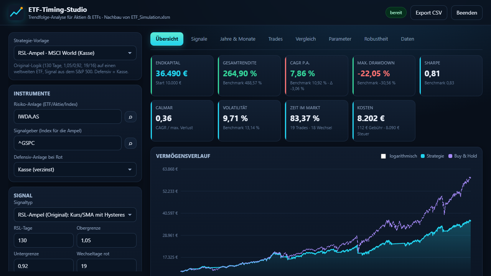
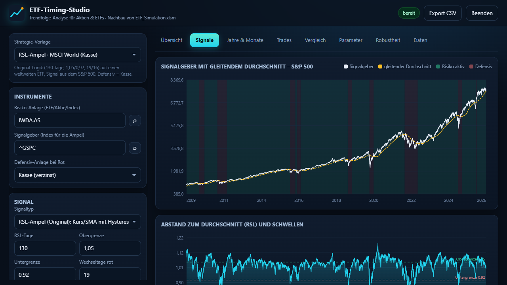
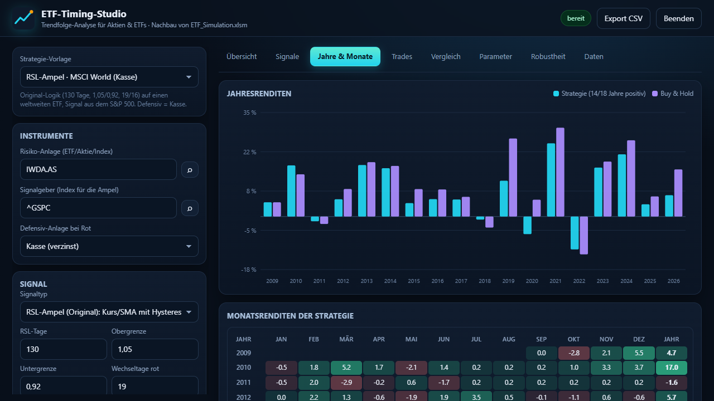
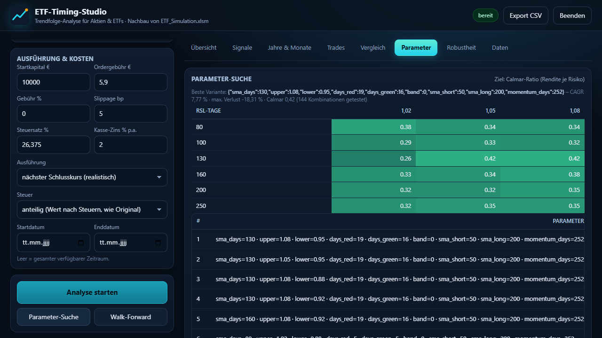
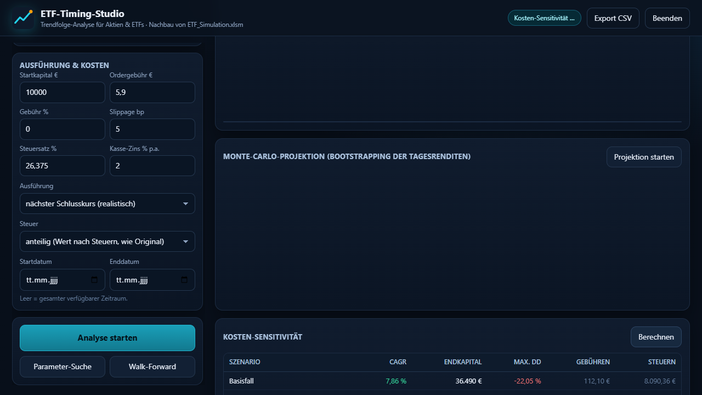

# Anleitung – ETF-Timing-Studio 1.1

**Ein Handbuch für die tägliche Arbeit mit dem Tool – für Aktien, ETFs, Indizes und Bitcoin.**
Für die Projektübersicht siehe `README_ETF_Tool.md`, für die Analyse der
Original-Arbeitsmappe siehe `Analyse_ETF_Simulation_Original.md`.

> **Neu in Version 1.1** (Details in [Kapitel 15](#15-rechengenauigkeit-und-validierung))
>
> * **Bitcoin & Krypto:** 7-Tage-Kalender, eigene Vorlagen, Steuerregel nach §23 EStG
>   (steuerfrei nach einem Jahr Haltedauer).
> * **Realistische Steuer:** Teilfreistellung, Sparerpauschbetrag, Verlusttopf mit Vortrag,
>   Besteuerung der Kassenzinsen, Ausweis der latenten Steuer.
> * **Neue Bewertungsaspekte:** Ulcer-Index, Martin-Ratio, VaR/CVaR, Beta, Jensen-Alpha,
>   Up-/Down-Capture, rollierende 1/3/5-Jahres-Renditen, Plateau-Analyse der Parametersuche.
> * **Belastbarere Robustheitstests:** Walk-Forward über das volle Parameterraster als
>   durchgehende Simulation mit Buy-&-Hold-Vergleich, Monte-Carlo als Block-Bootstrap.
> * **Datenqualitäts-Prüfung:** erkennt Datenfehler, Lücken und eingefrorene Kurse.
> * **Mehrere Rechenfehler behoben**, u. a. Benchmark im Steuermodus „nur bei Verkauf“,
>   Finanzierung synthetischer Short-Produkte, Sharpe/Sortino, CSV-Datumsformat.

---

## Inhalt

1. [Was das Tool für Sie tut](#1-was-das-tool-für-sie-tut)
2. [Voraussetzungen und Start](#2-voraussetzungen-und-start)
3. [In fünf Minuten zum ersten Ergebnis](#3-in-fünf-minuten-zum-ersten-ergebnis)
4. [Die Oberfläche verstehen](#4-die-oberfläche-verstehen)
5. [Instrumente auswählen](#5-instrumente-auswählen)
6. [Signaltypen und ihre Parameter](#6-signaltypen-und-ihre-parameter)
7. [Ausführung und Kosten](#7-ausführung-und-kosten)
8. [Steuern](#8-steuern)
9. [Die acht Reiter im Detail](#9-die-acht-reiter-im-detail)
10. [Bitcoin und andere Kryptowährungen](#10-bitcoin-und-andere-kryptowährungen)
11. [Ergebnisse sichern und weiterverwenden](#11-ergebnisse-sichern-und-weiterverwenden)
12. [Fünf typische Arbeitsabläufe](#12-fünf-typische-arbeitsabläufe)
13. [Daten verwalten](#13-daten-verwalten)
14. [Kennzahlen von A bis Z](#14-kennzahlen-von-a-bis-z)
15. [Rechengenauigkeit und Validierung](#15-rechengenauigkeit-und-validierung)
16. [Kommandozeile](#16-kommandozeile)
17. [Wenn etwas nicht funktioniert](#17-wenn-etwas-nicht-funktioniert)
18. [Grenzen und verantwortungsvoller Umgang](#18-grenzen-und-verantwortungsvoller-umgang)
19. [Anhang](#19-anhang)

---

## 1. Was das Tool für Sie tut

Das ETF-Timing-Studio simuliert **Trendfolge-Regeln** über historische Kurse von
Aktien, ETFs, Indizes und Kryptowährungen wie Bitcoin und beantwortet drei Fragen:

1. **Wann** wäre man investiert gewesen – und wann in Kasse?
2. **Was** hätte das gebracht (Rendite, Verlust, Schwankung) – nach Gebühren und
   deutscher Steuer?
3. **Wie belastbar** ist das Ergebnis – über verschiedene Zeiträume, Einstiegszeitpunkte,
   Parameter und Kostenannahmen?

Jede Strategie wird mit **Buy & Hold** desselben Instruments verglichen – mit exakt
denselben Kosten- und Steuerregeln. Nur so ist der Vergleich fair.

Es ist ein **Analysewerkzeug**, keine Handelssoftware und keine Anlageberatung.
Es sagt Ihnen nicht, was Sie morgen kaufen sollen, sondern was eine Regel in der
Vergangenheit geleistet hätte – ehrlich gerechnet, inklusive der unangenehmen
Ergebnisse.

---

## 2. Voraussetzungen und Start

### 2.1 Was Sie brauchen

| Voraussetzung | Details |
|---|---|
| Betriebssystem | Windows 10/11, macOS oder Linux |
| Python | **3.8 oder neuer**, keine Zusatzpakete nötig |
| Browser | Chrome, Edge, Firefox oder Safari (aktuell) |
| Internet | nur zum Laden von Kursen (CSV-Import geht offline) |

### 2.2 Start unter Windows

1. Den Ordner mit `ETF_Tool.py` öffnen.
2. **Doppelklick auf `Start_ETF_Tool.bat`.**
3. Es öffnet sich ein schwarzes Fenster (die Konsole) und kurz darauf der
   Browser mit der Oberfläche.

Beim ersten Mal kann Windows SmartScreen eine Warnung anzeigen – das ist bei
heruntergeladenen `.bat`-Dateien normal. Über „Weitere Informationen“ →
„Trotzdem ausführen“ starten.

### 2.3 Start unter macOS / Linux

```bash
python3 ETF_Tool.py
```

### 2.4 Was beim Start passiert

In der Konsole erscheint:

```
==========================================================================
  ETF-Timing-Studio 1.1
==========================================================================
  Oberfläche:  http://127.0.0.1:8765/
  Datenordner: …/data
  Beenden:     Strg+C im Fenster oder Button 'Beenden'
==========================================================================
```

* Der Server läuft **nur auf Ihrem Rechner** (`127.0.0.1`), nicht im Netzwerk.
* Ist Port 8765 belegt, wird automatisch ein freier Port gewählt – die
  tatsächliche Adresse steht immer in der Konsole.
* Der Browser öffnet sich selbst. Falls nicht: Adresse aus der Konsole
  kopieren und einfügen.

### 2.5 Beenden

| Weg | Wirkung |
|---|---|
| Button **„Beenden"** oben rechts | Server fährt herunter (nach Sicherheitsabfrage) |
| **Strg+C** in der Konsole | sofortiges Beenden |
| Browser-Tab schließen | **beendet den Server nicht** – er läuft weiter |

Es werden keine Dienste installiert, nichts startet automatisch mit.

### 2.6 Die Ordnerstruktur

```
ETF_Tool.py                     das Programm (die einzige nötige Datei)
Start_ETF_Tool.bat              Windows-Starter
README_ETF_Tool.md              Projektübersicht
Anleitung.md                    diese Anleitung (README.md ist eine Kopie)
Analyse_ETF_Simulation_Original.md   Reverse-Engineering der Excel-Datei
data/
  index.json                    Verzeichnis der geladenen Instrumente (inkl. Qualitätsstufe)
  cache/<SYMBOL>.json           Kursreihen (Datum, Schluss, adjustiert)
input/ETF_Simulation.xlsm       Original-Arbeitsmappe (nur für die Validierung)
screenshots/                    Bilder für die Dokumentation
tool_src/                       Quellteile, Build- und Testskripte (nur für Entwicklung)
```

`data/` wird beim ersten Download automatisch angelegt. Sie dürfen den Ordner
jederzeit löschen – das Tool startet dann „leer“ und lädt neu.

---

## 3. In fünf Minuten zum ersten Ergebnis

1. **Starten** (siehe 2.2). Beim allerersten Start sind keine Kurse vorhanden;
   in der Übersicht erscheint eine Willkommenskarte.
2. **„Standard-Daten laden“** klicken. Geladen werden `IWDA.AS` (MSCI World),
   `^GSPC` (S&P 500), `EXS1.DE` (DAX-ETF), `^GDAXI` (DAX) und `BTC-EUR` (Bitcoin) –
   das dauert wenige Sekunden.
3. Die Analyse läuft automatisch an. Oben rechts wechselt die Statuspille auf
   **„bereit“**, unten erscheint kurz eine grüne Meldung.
4. Sie sehen zehn Kennzahlenkarten, darüber gegebenenfalls **Hinweise**
   (z. B. zur Datenqualität), und den **Vermögensverlauf**.
5. Klicken Sie die Reiter durch: **Signale**, **Jahre & Monate**, **Trades**.
6. Zum Schluss **„Walk-Forward“** in der linken Spalte drücken und 10–30 Sekunden
   warten – das ist die ehrlichste Zahl im ganzen Tool.

> **Merksatz:** Erst Daten, dann Vorlage, dann „Analyse starten“ – und immer
> den Vergleich mit Buy & Hold im Blick behalten.

---

## 4. Die Oberfläche verstehen



> Die Abbildungen zeigen den Aufbau der Version 1.0. In Version 1.1 sind
> hinzugekommen: der Block „Steuer“ in der linken Spalte, die Hinweisbox über den
> Kennzahlen, weitere Kennzahlen und Tabellenzeilen sowie die Bereiche
> „Rollierende Renditen“, Datenqualität und erweiterte Robustheitsprüfungen.
> Sie sind in den folgenden Kapiteln beschrieben.

```
┌──────────────────────────────────────────────────────────────────────────┐
│  Logo   ETF-Timing-Studio                  [Status] [Export CSV] [Beenden]│
├───────────────────────┬──────────────────────────────────────────────────┤
│ STEUERUNG (links)     │  ARBEITSBEREICH (rechts)                         │
│                       │  ┌────────────────────────────────────────────┐  │
│ Strategie-Vorlage     │  │ Übersicht Signale Jahre Trades Vergleich … │  │
│ Instrumente           │  ├────────────────────────────────────────────┤  │
│ Signal                │  │ Hinweise (Vorlauf, Datenqualität, Währung) │  │
│ Ausführung & Kosten   │  │ Kennzahlenkarten                           │  │
│ Steuer                │  │ Diagramme, Tabellen                        │  │
│ [Analyse starten]     │  └────────────────────────────────────────────┘  │
│ [Parameter] [Walk-Fw] │                                                  │
└───────────────────────┴──────────────────────────────────────────────────┘
```

### 4.1 Die linke Spalte (Steuerung)

| Block | Inhalt |
|---|---|
| **Strategie-Vorlage** | neun fertige Konfigurationen (Anhang 19.2); Auswahl füllt alle Felder |
| **Instrumente** | Risiko-Anlage, Signalgeber, Defensiv-Anlage |
| **Signal** | Signaltyp und dessen Parameter |
| **Ausführung & Kosten** | Kapital, Gebühren, Slippage, Kasse-Zins, Ausführungszeitpunkt, Zeitraum |
| **Steuer** | Bewertungsmodus, Steuerregel, Abgeltungsteuer, Pauschbetrag, persönlicher Steuersatz, Freigrenze |
| **Aktionen** | „Analyse starten“, „Parameter-Suche“, „Walk-Forward“ |

### 4.2 Die Statuspille (oben rechts)

| Anzeige | Bedeutung |
|---|---|
| **bereit** (grün) | Server verbunden, nichts zu tun |
| **verbinde …** | Startphase |
| **rechne …** (blau) | eine Berechnung läuft (mit Fortschritts-Overlay) |
| **keine Daten** (gelb) | noch keine Kursreihen vorhanden |
| **Fehler** (rot) | letzter Vorgang fehlgeschlagen – Meldung unten lesen |
| **beendet** (gelb) | Server wurde heruntergefahren |

### 4.3 Meldungen und Hinweise

* Unten in der Mitte erscheint für ~4 Sekunden eine **Meldung**: grün = erfolgreich,
  rot = Fehler.
* Über den Kennzahlen zeigt die **Hinweisbox** alles, was die Aussage einschränkt:
  verschobener Start wegen Signal-Vorlauf, Datenfehler im Analysezeitraum (gelb),
  Kursindex ohne Dividenden und Werte in Fremdwährung (blau).
* Bei längeren Rechnungen legt sich ein Overlay mit Spinner über die Seite.
  Warten Sie, bis es verschwindet.
* **Tipp:** Fahren Sie mit der Maus über einen Kennzahlnamen in der Tabelle –
  ein Tooltip erklärt die Kennzahl.

### 4.4 Die Reiter

| Reiter | Kurzbeschreibung |
|---|---|
| **Übersicht** | Hinweise, Kennzahlen, Vermögensverlauf, Drawdown, Verlustphasen, Kennzahlentabelle |
| **Signale** | Kurs vs. Durchschnitt, RSL mit Schwellen, aktueller Zustand |
| **Jahre & Monate** | Jahresbalken, Monats-Heatmap, rollierende 1/3/5-Jahres-Renditen, Jahresübersicht |
| **Trades** | jede Order mit Kosten, Steuer, Gewinn und Haltedauer |
| **Vergleich** | dieselbe Regel auf mehreren Instrumenten |
| **Parameter** | Parametersuche mit Heatmap, Plateau-Analyse und Rangliste |
| **Robustheit** | Walk-Forward, Monte-Carlo, Kosten-Sensitivität |
| **Daten** | Kursbestand mit Qualitätsprüfung, Yahoo-Download, Schnellwahl, CSV-Import |

Die Reiter merken sich ihren Zustand: Wenn Sie die Analyse neu starten,
aktualisieren sich alle bereits berechneten Ansichten.

---

## 5. Instrumente auswählen

Drei Rollen sind zu besetzen:

| Feld | Rolle | Beispiel |
|---|---|---|
| **Risiko-Anlage** | Was wird gehalten, wenn das Signal „grün“ ist? | `IWDA.AS` (MSCI World), `BTC-EUR` |
| **Signalgeber** | Welche Reihe erzeugt das Signal? | `^GSPC` (S&P 500) oder dieselbe Reihe |
| **Defensiv-Anlage** | Was wird bei „rot“ gehalten? | Kasse (Standard) oder ein Anleihen-ETF |

### 5.1 Symbole finden

Neben jedem Feld steht eine **Lupe**. Klicken → Suchdialog → Begriff eingeben
(z. B. „MSCI World“, „DAX“, „Bitcoin“) → **auf einen Treffer klicken**.
Das Symbol wird übernommen und die Daten werden sofort geladen.

Alternativ tippen Sie das Symbol direkt ein; das Eingabefeld schlägt bereits
geladene Instrumente vor. Im Reiter **Daten** gibt es außerdem eine
**Schnellwahl** mit den wichtigsten Symbolen (ETFs, Indizes, Total-Return-Indizes,
Bitcoin, Ethereum, Bitcoin-ETPs) – ein Klick lädt die Reihe.

### 5.2 Sinnvolle Kombinationen

| Ziel | Risiko | Signal | Defensiv |
|---|---|---|---|
| Klassiker, breit gestreut | `IWDA.AS` | `^GSPC` oder `IWDA.AS` | Kasse |
| Länderwette Deutschland | `EXS1.DE` | `^GDAXI` | Kasse |
| Sehr lange Historie (Krisentest) | `^GSPC` | `^GSPC` | Kasse |
| Lange Historie mit Dividenden | `^SP500TR` | `^SP500TR` | Kasse |
| Mit Anleihen-Puffer | `IWDA.AS` | `^GSPC` | `IUAG.L` |
| Bitcoin mit Trendfilter | `BTC-EUR` | `BTC-EUR` | Kasse |
| Bitcoin über Börsen-ETP | `BTCE.DE` | `BTC-EUR` | Kasse |

### 5.3 Vier Regeln, die Sie kennen sollten

1. **Signalgeber ≠ Risiko-Anlage ist ausdrücklich erlaubt** und oft sinnvoll:
   Ein weltweiter ETF auf ein US-Signal (S&P 500) reagiert früher als auf sein
   eigenes, trägeres Signal.
2. **Signal = Risiko-Anlage** ist die einfachste Variante und vermeidet
   Verzögerungen durch unterschiedliche Handelstage.
3. **Defensiv-ETF nur mit Bedacht:** Ein Anleihen-ETF kann selbst fallen. Die
   Kasse (mit einstellbarem Zins) ist die konservativere Referenz.
4. **Verschiedene Kalender sind kein Problem:** Gehandelt wird immer mit dem
   Signal des **letzten Signaltags vor** dem Handelstag. Ein US-Feiertag oder ein
   Wochenende bei Bitcoin führt also nicht zu falschen oder doppelt verzögerten Signalen.

> **Tipp:** Wenn ein Feld leer bleibt oder das Symbol unbekannt ist, bricht der
> Lauf mit einer roten Meldung ab. Prüfen Sie dann die Schreibweise – ETFs
> brauchen das Börsenkürzel (`IWDA.AS`, nicht `IWDA`), Krypto die Währung (`BTC-EUR`).

### 5.4 Kursindex oder Total-Return-Index?

Viele Indizes sind **Kursindizes**: Dividenden fließen nicht ein. Das gilt für
`^GSPC` (S&P 500), `^NDX`, `^DJI`, `^STOXX50E` und die meisten ausländischen
Indizes. Der **DAX** (`^GDAXI`) ist dagegen ein Performance-Index mit Dividenden.

Mit einem Kursindex als Risiko-Anlage werden Buy & Hold **und** Strategie um die
Dividendenrendite unterschätzt (S&P 500 historisch etwa 2–3 % p. a.). Das Tool weist
darauf in der Hinweisbox hin. Für Renditevergleiche besser:

| Kursindex | mit Dividenden | Hinweis |
|---|---|---|
| `^GSPC` S&P 500 | `^SP500TR` | Total-Return-Index bei Yahoo ab 1988 |
| `^NDX` Nasdaq-100, `^DJI` Dow Jones | thesaurierender ETF | Yahoo liefert für die TR-Varianten keine Historie |
| `^STOXX50E` EURO STOXX 50 | thesaurierender ETF | – |

Als **Signalgeber** ist ein Kursindex unproblematisch – für das Signal zählt nur der Trend.

### 5.5 Währungen

Das Tool rechnet **in der Währung der Risiko-Anlage** und rechnet nicht in Euro um.
`BTC-USD`, `^GSPC` oder `SPY` liefern also Ergebnisse in US-Dollar; die Oberfläche
zeigt dann `$` statt `€` und einen Hinweis. Für Euro-Anleger sind Euro-Notierungen
aussagekräftiger: `IWDA.AS`, `SXR8.DE`, `BTC-EUR`, `BTCE.DE`.

---

## 6. Signaltypen und ihre Parameter

Die Auswahl **„Signaltyp“** bestimmt, welche Regel aus dem Signalgeber ein
An/Aus macht. Nicht benötigte Parameter werden ausgeblendet.

> **„Tage“ bedeutet „Kurse“:** An der Börse sind 252 Kurse etwa ein Jahr, bei
> Bitcoin (Handel an 7 Tagen pro Woche) sind es 365. Ein 200-Tage-Durchschnitt
> umfasst bei Bitcoin also gut 6,5 Kalendermonate, bei einem ETF gut 9 Monate.

### 6.1 RSL-Ampel (Original)

Die Regel aus der Original-Arbeitsmappe – mit Hysterese, damit nicht bei jedem
Zittern umgeschichtet wird.

| Parameter | Standard | Wirkung |
|---|---|---|
| **RSL-Tage** | 130 | Länge des gleitenden Durchschnitts. Kurz = nervös, lang = träge. Sinnvoll: 80–250 |
| **Obergrenze** | 1,05 | Ab hier sofort „grün“ (Kurs 5 % über Durchschnitt) |
| **Untergrenze** | 0,92 | Ab hier sofort „rot“ (8 % unter Durchschnitt) |
| **Wechseltage rot** | 19 | So viele Tage unter 1,0 in Folge → rot |
| **Wechseltage grün** | 16 | So viele Tage über 1,0 in Folge → grün |

**So wirkt es:** Die Schwellen sind die Notbremse (schnelle Reaktion bei
starken Bewegungen), die Wechseltage der Filter gegen Seitwärts-Gezappel.
Kleinere Obergrenze/größere Untergrenze = frühere, aber häufigere Wechsel.

### 6.2 SMA-Trend

| Parameter | Standard | Wirkung |
|---|---|---|
| **SMA-Tage** | 200 (Vorlage „200-Tage-SMA“) | Kurs über Durchschnitt → investiert |
| **Hysterese ±** | 0,00 | Pufferzone um 1,0 (z. B. 0,02 = erst bei +2 % rein, bei −2 % raus) |

Der bekannteste Filter („200-Tage-Linie“) – auch bei Bitcoin beliebt. Ohne
Hysterese wechselt er in Seitwärtsmärkten häufig.

### 6.3 Golden Cross

| Parameter | Standard | Wirkung |
|---|---|---|
| **kurzer SMA** | 50 | schneller Durchschnitt |
| **langer SMA** | 200 | langsamer Durchschnitt |

Investiert, solange der kurze über dem langen liegt. Träger als der reine
Kurs/SMA-Vergleich, dafür weniger Fehlsignale.

### 6.4 Momentum

| Parameter | Standard | Wirkung |
|---|---|---|
| **Momentum-Tage** | 252 (Börse) bzw. 365 (Krypto) | investiert, wenn die Rendite der letzten N Kurse positiv ist |

Ein Klassiker aus der Faktor-Forschung („12-Monats-Momentum“), sehr robust, aber
spät bei Wendepunkten.

### 6.5 Vorlauf: Wann beginnt der Test?

Ein 200-Tage-Durchschnitt braucht 200 Kurse, bevor er existiert. Das Tool startet den
Backtest deshalb **erst, wenn das Signal gültig ist** (und beginnt nicht – wie in
Version 1.0 – mit einem automatisch „grünen“ Signal). Ist der gewählte Start früher,
wird er verschoben; die Hinweisbox nennt das neue Startdatum. Dasselbe gilt, wenn die
Signaldaten später beginnen als die Kurse der Risiko-Anlage.

### 6.6 Was Sie beim Probieren sehen werden

* **Mehr Hysterese** → weniger Trades, weniger Gebühren, späteres Aussteigen.
* **Kürzere Durchschnitte** → früher raus, aber mehr Fehlsignale in Seitwärtsphasen.
* **Alle Varianten** liefern über lange Zeiträume meist **etwas weniger Rendite**
  als Buy & Hold, dafür **deutlich kleinere Drawdowns**. Das ist kein Fehler,
  sondern der eigentliche Zweck.

---

## 7. Ausführung und Kosten

### 7.1 Kapital und Gebühren

| Feld | Standard | Hinweis |
|---|---|---|
| **Startkapital** | 10.000 | frei wählbar; alle Beträge skalieren mit |
| **Ordergebühr fix** | 5,90 (Krypto-Vorlagen: 0) | fix pro Order (Kauf *und* Verkauf) |
| **Gebühr %** | 0 (Krypto-Vorlagen: 0,25) | prozentualer Anteil, wie bei Krypto-Börsen oder manchen Brokern |
| **Slippage bp** | 5 (Krypto-Vorlagen: 15) | 1 bp = 0,01 %. Auf-/Abschlag auf den Kurs je Ausführung (Spread) |

**Rechenbeispiel:** Bei 5,90 € fix und 20 Orders entstehen 118 € Gebühren. Auf
10.000 € Startkapital ist das ~1,2 % – bei häufigem Umschichten wird das zum
Renditekiller. Prozentgebühren wachsen dagegen mit dem Depot: 0,25 % auf ein
Depot von 500.000 € sind 1.250 € je Order.

### 7.2 Kasse und Ausführung

| Feld | Standard | Bedeutung |
|---|---|---|
| **Kasse-Zins % p.a.** | 2,0 | Verzinsung des nicht investierten Kapitals (Tagesgeld); dient auch als risikoloser Zins für Sharpe und Sortino |
| **Ausführung** | nächster Schlusskurs | siehe unten |

Der Zins läuft **kalendertaggenau** (auch über Wochenenden), monatlich gutgeschrieben
und versteuert (Kapitel 8.6). 2 % p. a. ergeben also genau 2 % – bei Aktien wie bei Bitcoin.

| Ausführung | Bedeutung | Empfehlung |
|---|---|---|
| **nächster Schlusskurs** | Signal vom Schlusskurs des letzten Signaltags vor dem Handelstag, gehandelt zum Schlusskurs des Handelstags | **realistisch**, Standard |
| **gleicher Schlusskurs** | Signal und Handel am selben Schlusskurs | wie im Original – **optimistisch**, weil man den Schlusskurs erst danach kennt |

Bei „gleicher Schlusskurs“ und einem Signal von einer **später schließenden Börse**
(z. B. S&P-500-Signal für einen Xetra-ETF) entsteht sogar ein Blick in die Zukunft:
Der US-Schluss liegt nach dem Xetra-Schluss. Für ernsthafte Aussagen immer
„nächster Schlusskurs“ verwenden.

### 7.3 Zeitraum

**Startdatum/Enddatum** leer lassen = gesamter verfügbarer Zeitraum, beginnend mit
dem ersten Tag, an dem das Signal gültig ist (Kapitel 6.5). Für faire Vergleiche
zwischen Instrumenten denselben Zeitraum eintragen.

---

## 8. Steuern

Das Tool bildet die Besteuerung eines **deutschen Privatanlegers** vereinfacht nach.
Buy & Hold wird **immer mit denselben Regeln** gerechnet wie die Strategie.

### 8.1 Bewertung (Modus)

| Modus | Was passiert | Wann sinnvoll |
|---|---|---|
| **anteilig** (Standard) | Täglich wird so gerechnet, als würden Sie jetzt verkaufen: Ordergebühr, Slippage und Steuer auf den noch nicht realisierten Gewinn werden abgezogen („Wert nach Steuern“ wie in der Original-Arbeitsmappe). | Ehrlicher Vergleich mit Buy & Hold, das seine Steuer ja auch noch schuldet |
| **nur bei Verkauf** | Steuer fällt erst beim tatsächlichen Verkauf an; gehaltene Positionen werden brutto bewertet. | Wenn Sie echte Zahlungsströme sehen wollen |
| **keine** | Ignoriert Steuer vollständig. | Vorsteuer-Vergleich, internationale Vergleiche |

### 8.2 Steuerregel

| Regel | Für | Besteuerung |
|---|---|---|
| **automatisch je Instrument** (Standard) | alle | wählt die Regel aus Instrumenttyp und Name (siehe unten) |
| **Aktienfonds/-ETF** | Aktien-ETFs, Indizes (als ETF-Stellvertreter) | Abgeltungsteuer auf 70 % des Gewinns (30 % Teilfreistellung) |
| **Mischfonds** | Multi-Asset-Fonds | Abgeltungsteuer auf 85 % des Gewinns |
| **Wertpapier ohne Teilfreistellung** | Einzelaktien, Anleihe-ETFs, Short-Produkte | Abgeltungsteuer auf den vollen Gewinn (wie im Original) |
| **Privates Veräußerungsgeschäft (§23 EStG)** | Bitcoin & Krypto, physische Gold-/Bitcoin-ETCs wie Xetra-Gold oder BTCE | **steuerfrei nach mehr als 1 Jahr Haltedauer**; sonst persönlicher Steuersatz, Freigrenze |

**Automatische Zuordnung:** Kryptowährungen (Yahoo-Typ „CRYPTOCURRENCY“) sowie
Instrumente mit „Bitcoin“, „Ethereum“, „Gold“ usw. im Namen (aber nicht „Miners“
oder „Aktien“) → §23; Namen mit „Bond“, „Anleihe“, „Treasury“, „Aggregate“ usw. →
ohne Teilfreistellung; Einzelaktien → ohne Teilfreistellung; ETFs, Indizes und
CSV-Importe → Aktienfonds. Die Zuordnung ist eine **Näherung** – wählen Sie die
Regel bei Bedarf von Hand. Die verwendete Regel steht in der Kennzahlentabelle.

### 8.3 Teilfreistellung

Bei Aktienfonds (mindestens 51 % Aktien) sind 30 % der Gewinne steuerfrei, bei
Mischfonds 15 %. Verluste zählen im selben Verhältnis. Aus 26,375 % Abgeltungsteuer
wird bei Aktien-ETFs effektiv **18,46 %**.

### 8.4 Sparerpauschbetrag und Verlusttopf

* **Sparerpauschbetrag** (Standard 1.000 € pro Jahr, Verheiratete 2.000 €): Kapitalerträge
  bis zu diesem Betrag bleiben je Kalenderjahr steuerfrei. Nicht genutzter Betrag
  verfällt am Jahresende.
* **Verlusttopf:** Realisierte Verluste werden mit späteren Gewinnen verrechnet – erst
  danach greift der Pauschbetrag. Fällt ein Verlust im selben Jahr nach einem
  versteuerten Gewinn an, wird die Steuer **erstattet** (wie bei der Bank); ein
  Restverlust wird **ins nächste Jahr vorgetragen**.
* Strategien mit Verkäufen in mehreren Jahren können den Pauschbetrag mehrfach nutzen –
  Buy & Hold nur einmal (beim fiktiven Verkauf). Das ist ein echter, oft übersehener
  Vorteil des Umschichtens.

### 8.5 Private Veräußerungsgeschäfte (§23 EStG): Bitcoin, Gold-ETCs

| Regel | Umsetzung |
|---|---|
| Haltefrist | Verkauf **mehr als ein Jahr** nach dem Kauf: Gewinn (und Verlust) steuerfrei |
| Steuersatz | innerhalb der Frist: **persönlicher Steuersatz** (Feld „Pers. Steuersatz % (§23)“, Standard 35 %) |
| Freigrenze | Gesamtgewinn eines Jahres unter **1.000 €** (seit 2024; bis 2023: 600 €) bleibt steuerfrei; ab 1.000 € ist der ganze Gewinn steuerpflichtig |
| Verluste | nur mit §23-Gewinnen verrechenbar, Vortrag in Folgejahre |

Jeder neue Kauf startet die Haltefrist neu. Eine Timing-Strategie, die mehrmals im
Jahr umschichtet, versteuert ihre Gewinne deshalb fast immer voll – Buy & Hold nach
einem Jahr gar nicht. In der Bewertung „anteilig“ springt der Buy-&-Hold-Wert nach
einem Jahr Haltedauer deshalb sichtbar nach oben (die latente Steuer entfällt).

### 8.6 Zinsen auf die Kasse

Kassenzinsen sind Kapitalerträge: Sie werden monatlich gutgeschrieben und mit
Abgeltungsteuer belegt (unter Nutzung von Pauschbetrag und Verlusttopf).

### 8.7 Gezahlte und latente Steuer

| Ausweis | Bedeutung |
|---|---|
| **Steuer gezahlt (netto)** | bei Verkäufen und Zinsgutschriften gezahlt, abzüglich Erstattungen |
| **Latente Steuer am Ende** | Steuer, die bei einem Verkauf am letzten Tag zusätzlich anfiele (Strategie und Buy & Hold getrennt) |

Im Modus „anteilig“ ist die latente Steuer im Endkapital bereits abgezogen, im Modus
„nur bei Verkauf“ nicht.

### 8.8 Rechenbeispiele: 1.000 € realisierter Gewinn (26,375 % Abgeltungsteuer)

| Fall | Steuer |
|---|---|
| Wertpapier ohne Teilfreistellung, ohne Pauschbetrag | 263,75 € |
| Aktien-ETF (30 % Teilfreistellung), ohne Pauschbetrag | 184,63 € |
| Aktien-ETF, Pauschbetrag 1.000 € noch frei | 0,00 € |
| Bitcoin, nach 8 Monaten verkauft, 35 % persönlicher Satz | 350,00 € (bei 999 € Gewinn: 0 € – Freigrenze) |
| Bitcoin, nach 13 Monaten verkauft | 0,00 € |

### 8.9 Was nicht abgebildet ist

Vorabpauschale bei thesaurierenden Fonds, Kirchensteuer (kann über den Steuersatz
eingerechnet werden: 27,82 % bei 8 % bzw. 27,99 % bei 9 % Kirchensteuer), getrennter
Aktien-Verlusttopf, Günstigerprüfung, ausländische Quellensteuer sowie die Zuordnung von
Teilverkäufen (es gibt immer nur eine Position).

---

## 9. Die acht Reiter im Detail

### 9.1 Übersicht

**Zweck:** In zehn Sekunden erkennen, ob die Strategie etwas taugt.

**Hinweisbox** (falls nötig): verschobener Start wegen Signal-Vorlauf, Datenfehler im
Analysezeitraum, Kursindex ohne Dividenden, Werte in Fremdwährung. Gelbe Hinweise
**vor** der Interpretation lesen – ein Datenfehler kann jedes Ergebnis entwerten.

**Zehn Kennzahlenkarten** (grüner Rand = besser als Buy & Hold, roter = schlechter):

| Karte | Was sie zeigt | Worauf achten |
|---|---|---|
| Endkapital | Endwert nach Kosten und Steuer, darunter Buy & Hold | mit Startkapital und B&H vergleichen |
| CAGR p. a. | Jahresrendite, darunter B&H und Differenz Δ | **Δ negativ ist bei Timing normal** |
| Max. Drawdown | größter Verlust vom Hoch | **kleiner als B&H = Zweck erfüllt** |
| Calmar | CAGR / max. Drawdown | **die wichtigste Kennzahl für Timing** |
| Sharpe | Überrendite über Kasse-Zins je Schwankung | > 0,5 ordentlich |
| Ulcer-Index | Tiefe **und** Dauer der Verluste | kleiner ist besser |
| Up / Down-Capture | Anteil an den Gewinn- bzw. Verlustmonaten von B&H | ideal: Up hoch, Down niedrig |
| Volatilität | annualisierte Schwankung | Timing senkt sie meist |
| Zeit im Risiko | Anteil der Tage mit Risiko-Anlage, Orders, Wechsel pro Jahr | viele Wechsel = Kosten und Steuer |
| Kosten & Steuer | Gebühren, gezahlte und latente Steuer | bei häufigen Trades kritisch |

**Vermögensverlauf:** cyan = Strategie, violett gestrichelt = Buy & Hold.
Die Checkbox **„logarithmisch“** ist bei langen Zeiträumen und Bitcoin hilfreich.
Unter dem Diagramm läuft ein **Signalband**: grün = investiert, rot = defensiv.

**Drawdown:** Verlust vom jeweils letzten Hoch; gestrichelt = Buy & Hold.

**Größte Verlustphasen:** die fünf tiefsten Einbrüche mit Hoch, Tief, Erholungsdatum
(oder „noch nicht erholt“) und Dauer in **Kalendertagen**.

**Kennzahlen im Vergleich:** alle Werte für Strategie und Buy & Hold, gruppiert nach
Rendite · Risiko · risikoadjustiert · Bezug zu Buy & Hold · Handel · Kosten & Steuer ·
Zeitraum. Ein Tooltip erklärt jede Kennzahl; die Definitionen stehen in Kapitel 14.

### 9.2 Signale



**Zweck:** Prüfen, ob das Signal plausibel arbeitet.

* **Oberes Diagramm:** Kurs des Signalgebers (weiß) und gleitender Durchschnitt
  (gelb). Grüne Flächen = Risiko war aktiv, rote Flächen = defensiv.
* **Unteres Diagramm:** der RSL-Wert (Kurs / Durchschnitt) mit Schwellen
  (Obergrenze grün, 1,0 grau, Untergrenze rot).
* **Aktueller Signalzustand:** Zustand (RISIKO AKTIV / DEFENSIV), Abstand zum
  Durchschnitt, Anteil der Risikophasen, Datum des letzten Wechsels.

In starken Trends bleibt das Signal lange grün, in Seitwärtsphasen wechselt es
mehrfach. Genau dort entstehen die Kosten.

### 9.3 Jahre & Monate



**Zweck:** Erkennen, *wann* die Strategie hilft und wann sie schadet.

* **Jahresrenditen:** Balkenpaare je Jahr. Die Legende zählt positive Jahre und Jahre
  besser als Buy & Hold; `*` markiert angebrochene Jahre (Teiljahre). Das erste Jahr
  bezieht sich auf das Startkapital – die Jahresrenditen ergeben verkettet genau die
  Gesamtrendite.
* **Monats-Heatmap:** Zeilen = Jahre, Spalten = Monate, Farbe = Rendite, letzte Spalte
  = Jahresergebnis.
* **Rollierende Renditen (neu):** Für jeden möglichen Einstiegstag die annualisierte
  Rendite über 1, 3 oder 5 Jahre – Strategie gegen Buy & Hold. Die Tabelle darunter
  zeigt je Anlagedauer, **wie oft die Strategie vorn lag**, wie oft man mit Verlust
  dastand und die schlechtesten, mittleren und besten Zeiträume. Das beantwortet die
  Frage „Wie stark hängt das Ergebnis von meinem Einstiegszeitpunkt ab?“ (Die
  Zeiträume überlappen sich; Anteile sind deshalb keine unabhängigen Wahrscheinlichkeiten.)
* **Jahresübersicht:** Strategie, Benchmark, Differenz, Endstände – neueste Jahre oben.

**Lesart:** Eine Timing-Strategie „gewinnt“ meist in wenigen Krisenjahren und
„verliert“ in vielen Aufwärtsjahren leicht. Bei den rollierenden Renditen ist ihr
typisches Profil: Sie liegt **seltener vorn**, hat aber **seltener Verlustzeiträume**
über 3 und 5 Jahre (S&P 500 seit 1970: 5-Jahres-Verluste in 3 % statt 18 % der
Zeiträume).

### 9.4 Trades

**Zweck:** Jede Order nachvollziehen – und die Kosten sehen.

Oben acht Kennzahlen: Orders und abgeschlossene Positionen, Gewinnquote,
**Profit-Faktor**, Ø Gewinn / Ø Verlust, Ø Haltedauer mit **Fehlsignalen** (Positionen
unter 30 Tagen), **längste Verlustserie**, Gebühren, Steuern.

Die Tabelle zeigt je Order: Datum, Aktion, Instrument, Ausführungskurs (inkl. Slippage),
Stück, Wert, Gebühr, Steuer (negativ = Erstattung), realisierten Gewinn,
**Haltedauer** und Anlass. Über das Auswahlfeld lässt sich auf Käufe oder Verkäufe filtern.

**Worauf achten:**

* Viele Fehlsignale sind ein Warnsignal für Zappeln.
* Viele kleine Verluste bei wenigen großen Gewinnen = typisches Trendfolge-Profil;
  ein Profit-Faktor deutlich über 1 zeigt, dass die Gewinne die Verluste tragen.
* Die Gewinnquote ist bei Trendfolge oft **niedrig** (30–50 %) – das ist normal.

### 9.5 Vergleich


**Zweck:** Dieselbe Regel auf mehreren Instrumenten testen.

1. In der Liste (Mehrfachauswahl) Instrumente markieren – **Strg** (Windows)
   bzw. **Cmd** (Mac) gedrückt halten.
2. **„Vergleich starten“**.
3. Ergebnis: Tabelle sortiert nach CAGR mit Zeitraum, CAGR und Drawdown jeweils gegen
   Buy & Hold, Sharpe, Calmar gegen Buy & Hold, Up/Down-Capture, Zeit im Risiko,
   Endwert und **Datenqualität** des Instruments; darunter ein Balkendiagramm.

Der Vergleich nutzt **alle aktuellen Einstellungen** (Signal, Kosten, Steuer, Zeitraum),
nur die Risiko-Anlage wird ausgetauscht. Eine Monatsrotation wird dabei deaktiviert.
Vergleichen Sie nur Instrumente mit ähnlichem Zeitraum; Endwerte stehen in der Währung
des jeweiligen Instruments.

### 9.6 Parameter



**Zweck:** Herausfinden, ob die Strategie nur mit einer zufällig passenden
Parameterkombination funktioniert.

1. **„Parameter-Suche“** klicken (linke Spalte oder Reiter).
2. Das Tool rechnet alle Kombinationen über **denselben Zeitraum** (gemeinsamer Vorlauf):
   * RSL-Ampel: 144 (6 RSL-Längen × 3 Obergrenzen × 4 Untergrenzen × 2 Wechseltag-Paare)
   * SMA-Trend: 18 · Golden Cross: 9 · Momentum: 6 (21 bis 365 Tage)
3. Über **„Ziel“** wählen Sie die Sortierung: Calmar, Martin (Ulcer), Sharpe oder CAGR.
4. Ergebnis:
   * **Beste Variante** nach dem gewählten Ziel,
   * **Plateau-Anteil:** wie viele Kombinationen mindestens 80 % des Bestwerts erreichen,
   * **Heatmap** RSL-Tage × Obergrenze (bester Wert je Zelle, nur RSL-Ampel),
   * **Rangliste** mit CAGR, Drawdown, Sharpe, Calmar, Martin, Volatilität, Zeit im
     Risiko und Orders.
5. **„übernehmen“** setzt die Parameter in die Steuerung – danach **„Analyse
   starten“** drücken.

**So lesen Sie das Ergebnis richtig:** Sie suchen keine einzelne grüne Zelle,
sondern **einen grünen Bereich**. Ein hoher Plateau-Anteil heißt: Viele benachbarte
Einstellungen funktionieren ähnlich gut – die Regel ist stabil. Ist nur ein einzelner
Punkt gut, ist das ein Artefakt (Überanpassung).

> Die Suche zeigt die beste **In-Sample**-Variante. Ob sie auch künftig gilt,
> sagt erst der Walk-Forward-Test.

### 9.7 Robustheit



Drei Prüfungen, die aus einem „schönen“ Ergebnis ein belastbares machen:

**a) Walk-Forward** (Ziel wählbar: Calmar / Martin / CAGR / Sharpe)

* Ablauf: 6 Kalenderjahre Training → 2 Jahre Test, dann 2 Jahre weiterrollen. In jedem
  Trainingsfenster wird aus dem **vollen Parameterraster** (bei der RSL-Ampel alle 144
  Kombinationen) die beste gewählt und im *folgenden* Testfenster angewendet.
* Die Testfenster laufen als **eine durchgehende Simulation**: Die Parameter wechseln an
  den Fenstergrenzen, Positionen und Steuerstand laufen weiter (keine künstlichen
  Verkäufe). **Buy & Hold** läuft über denselben Zeitraum mit.
* Ergebnis: Out-of-Sample-CAGR, -Drawdown und -Calmar gegen Buy & Hold, die
  **Basis-Parameter ohne Optimierung** über denselben Zeitraum, Anzahl positiver und
  B&H-schlagender Testfenster, Kurve und Fenstertabelle.
* Liegt die optimierte OOS-Rendite unter der Rendite der festen Basis-Parameter, zeigt
  das Tool einen Hinweis: Die Optimierung war **Überanpassung**. (Beispiel MSCI World
  2016–2026: optimiert 7,1 % p. a., feste Original-Parameter 8,1 %, Buy & Hold 10,9 %.)
* Dauer: wenige Sekunden, bei 50+ Jahren Historie bis ca. 30 Sekunden.

**Was bedeuten die Ziele?**

| Ziel | Formel | Verhalten bei der Optimierung |
|---|---|---|
| **Calmar** | CAGR / Betrag des max. Drawdowns | wählt die am besten „durchhaltbare“ Variante; **Empfehlung für Timing** |
| **Martin** | (CAGR − Kasse-Zins) / Ulcer-Index | wie Calmar, berücksichtigt aber alle Verlustphasen statt nur der tiefsten |
| **CAGR** | (Endwert / Start)^(1 / Jahre) − 1 | wählt die ertragreichste Variante – auch mit tiefen Einbrüchen |
| **Sharpe** | Überrendite / Volatilität | wählt die glatteste Variante |

Das Ziel steuert **nur die Parameterauswahl im Trainingsfenster**; die OOS-Kennzahlen
werden danach unabhängig gemessen. Schneidet **derselbe** Parametersatz bei mehreren
Zielen gut ab, ist das ein Zeichen für Robustheit.

**b) Monte-Carlo** (Block-Bootstrap, 10 Jahre)

* 500 simulierte Zukünfte aus **Blöcken historischer Tagesrenditen** (≈ 1 Monat je
  Block). Anders als beim Ziehen einzelner Tage bleiben so Krisenhäufungen erhalten –
  genau die Phasen, in denen sich Timing beweisen muss.
* Strategie und Buy & Hold ziehen **dieselben Blöcke** (gepaarter Vergleich).
* Ergebnis: Median sowie schlechte und gute 5 % nach 10 Jahren (ab Startkapital),
  **Verlust-Wahrscheinlichkeit**, Anteil der Pfade, in denen die Strategie vor
  Buy & Hold liegt, und der **typische maximale Drawdown** (Median und schlechte 5 %).
* Bei großer Spannweite (z. B. Bitcoin) wird das Diagramm logarithmisch dargestellt.
* **Wichtig:** keine Prognose – nur die Bandbreite, die aus dem bisherigen Verhalten folgt.

**c) Kosten-Sensitivität**

* Zehn Szenarien: Basisfall, ohne Gebühren, ohne Slippage, ohne Steuer, Gebühr 15
  bzw. 30, Slippage 25/50 bp, **Ausführung 1 Tag später**, **Kasse ohne Zins**.
* Spalte **„Δ zu B&H“**: Abstand zu Buy & Hold unter denselben Annahmen.
* Bricht der Vorteil schon bei einem Tag Verzögerung oder höheren Kosten ein, ist die
  Regel nicht belastbar. „Kasse ohne Zins“ zeigt, wie viel der Kassenzins zum Ergebnis
  beiträgt.

### 9.8 Daten

**Zweck:** Kursbestand pflegen und prüfen.

* **Datenbestand:** alle geladenen Reihen mit Symbol, Name, Quelle, Währung, Zeitraum,
  Anzahl Kurse, **Qualität** (✓ ok · ℹ Hinweis · ⚠ prüfen) und Aktualisierungszeit.
* **„prüfen“** öffnet unter der Zeile den Qualitätsbericht (Kapitel 13.4) und
  aktualisiert die Qualitätsstufe. **„löschen“** entfernt die Reihe.
* **„Aktualisieren“** lädt nur die *Liste* neu (nicht die Kurse).
* **Kurse von Yahoo Finance laden:** Symbole durch Komma oder Leerzeichen getrennt
  eingeben, „Laden“ klicken – oder einen Eintrag der **Schnellwahl** anklicken.
* **CSV importieren:** Namen vergeben, Datei wählen – der Import läuft sofort und
  meldet erkanntes Datumsformat, Dezimalzeichen und Datenqualität.

---

## 10. Bitcoin und andere Kryptowährungen

### 10.1 Welche Symbole?

| Symbol | Was | Daten ab |
|---|---|---|
| `BTC-EUR` | Bitcoin in Euro (Börsenkurs-Mittel, 7 Tage pro Woche) | 2014 |
| `BTC-USD` | Bitcoin in US-Dollar (Ergebnisse dann in $) | 2014 |
| `ETH-EUR` | Ethereum in Euro | 2017 |
| `BTCE.DE` | Bitwise Physical Bitcoin ETC, Xetra (EUR, Börsenhandelstage) | 2020 |
| `VBTC.DE` | VanEck Bitcoin ETN, Xetra (EUR) | 2020 |
| `IBIT` | iShares Bitcoin Trust (US-ETF, USD) | 2024 |

Für lange Tests eignet sich `BTC-EUR` (auch als Signalgeber). Wer über ein
Börsenprodukt handelt, kann `BTCE.DE` als Risiko-Anlage und `BTC-EUR` als Signal
kombinieren.

### 10.2 Was bei Krypto anders ist

* **Kalender:** Bitcoin wird an 365 Tagen gehandelt. Das Tool erkennt das an den Daten
  und rechnet alle Annualisierungen (Volatilität, Sharpe, rollierende Fenster,
  Monte-Carlo-Horizont) mit 365 statt 252 Kursen je Jahr. „200 Tage“ sind 200 Kalendertage.
* **Kosten:** Krypto-Börsen und -Broker berechnen meist Prozentgebühren und Spreads. Die
  Bitcoin-Vorlagen nutzen 0,25 % Gebühr plus 15 bp Slippage und keine Fixgebühr –
  passen Sie das an Ihren Anbieter an (Spreads von 0,5–1,5 % sind bei Neobrokern üblich).
* **Steuer:** Bitcoin und physisch hinterlegte ETCs fallen unter §23 EStG
  (Kapitel 8.5): steuerfrei nach einem Jahr Haltedauer. Das begünstigt Buy & Hold
  stark – eine Timing-Strategie mit mehreren Wechseln pro Jahr versteuert ihre Gewinne
  dagegen mit dem persönlichen Steuersatz.
* **Schwankung:** Tagesbewegungen von 20–40 % kommen vor (März 2020: −37 %). Die
  Datenqualitäts-Prüfung stuft solche Tage in unruhigen Phasen als echte
  Marktbewegung ein.

### 10.3 Was die Vorlagen zeigen (Daten bis 11/2026)

| Strategie (BTC-EUR, Kasse 2 %) | CAGR | Buy & Hold | Max. DD | DD B&H | Calmar | B&H | Zeit im Risiko |
|---|---|---|---|---|---|---|---|
| 200-Tage-SMA, 2015–2026 | 52,7 % | 63,2 % | −68,3 % | −82,7 % | 0,77 | 0,76 | 61 % |
| Momentum 365 Tage, 2015–2026 | 60,2 % | 68,6 % | −82,6 % | −82,7 % | 0,73 | 0,83 | 72 % |

Lesart: Der 200-Tage-Filter senkt den maximalen Verlust deutlich (−68 % statt −83 %),
kostet aber gut 10 Prozentpunkte Rendite pro Jahr – zum Teil wegen Gebühren und der
Steuer auf kurzfristige Gewinne, die Buy & Hold nach einem Jahr nicht zahlt. Über
5 Jahre lag der Filter nur in 18 % der Zeiträume vor Buy & Hold. Bitcoin bleibt auch
mit Trendfilter ein Instrument mit sehr hohen Verlustphasen.

---

## 11. Ergebnisse sichern und weiterverwenden

### 11.1 CSV-Export

Button **„Export CSV“** (oben rechts) erzeugt eine Datei
`etf_timing_<SYMBOL>_<JJJJMMTT_HHMM>.csv` im Download-Ordner. Aufbau:

1. **Zeitreihe:** `Datum;Strategie;Benchmark;Drawdown;Drawdown Benchmark;Signal;Position`
   (Signal 1 = Risiko, 0 = defensiv)
2. **Kennzahlen:** `Kennzahl;Wert` – alle Kennzahlen aus Kapitel 14 unter ihrem
   internen Namen (z. B. `cagr`, `bench_cagr`, `ulcer_index`, `up_capture`)
3. **Jahreswerte:** `Jahr;Strategie;Benchmark;Endstand;Endstand Benchmark;Teiljahr`
4. **Trades:** `Datum;Aktion;Instrument;Kurs;Stueck;Wert;Gebuehr;Steuer;Gewinn;Haltedauer Tage`

Trennzeichen ist **Semikolon** mit **Komma als Dezimaltrenner**, die Datei ist UTF-8
mit Kennung (BOM) – sie öffnet sich in Excel und LibreOffice (deutsche Einstellung)
direkt in Spalten, Umlaute inklusive. Renditen stehen als Dezimalzahl (0,0908 = 9,08 %).

### 11.2 Reiter direkt verlinken

```
http://127.0.0.1:8765/#overview
http://127.0.0.1:8765/#signals
http://127.0.0.1:8765/#periods
http://127.0.0.1:8765/#trades
http://127.0.0.1:8765/#compare
http://127.0.0.1:8765/#params
http://127.0.0.1:8765/#robust
http://127.0.0.1:8765/#data
```

### 11.3 Einstellungen „sichern“

Das Tool speichert **keine Konfigurationen** (bewusst: keine versteckten
Zustände). Wenn Sie eine Konfiguration festhalten wollen: Screenshot der linken
Spalte, Notiz der Werte oder – reproduzierbar – die **Kommandozeile** mit JSON
(Kapitel 16).

---

## 12. Fünf typische Arbeitsabläufe

### A) „Lohnt Timing für meinen Welt-ETF?“

1. Vorlage **„RSL-Ampel · MSCI World (Kasse)“**.
2. **Analyse starten**; Hinweisbox lesen.
3. Auf der Übersicht **Calmar**, **Max. Drawdown** und **Up/Down-Capture** mit Buy &
   Hold vergleichen.
4. Reiter **Jahre & Monate**: In welchen Jahren half es? Wie oft lag die Strategie
   über 3 und 5 Jahre vorn (rollierende Renditen)?
5. **Walk-Forward** starten: Bleibt der Vorteil out-of-sample erhalten – und war die
   Optimierung besser als die festen Parameter?

**Erwartetes Ergebnis:** etwas weniger Rendite, deutlich kleinerer Drawdown,
gleiche oder bessere Calmar-Ratio. Wenn nicht – Regel verwerfen.

### B) „Welche Parameter sind stabil?“

1. Signaltyp RSL-Ampel wählen.
2. **Parameter-Suche** → Plateau-Anteil und Heatmap ansehen: Gibt es ein *Feld* guter Werte?
3. Ziel auf „Martin“ umstellen – bleibt der gute Bereich derselbe?
4. Aus dem guten Bereich einen **mittleren** Wert „übernehmen“ (nicht den
   Spitzenreiter – der ist am stärksten überangepasst).
5. **Analyse starten**, dann **Walk-Forward** und **Kosten-Sensitivität**.

### C) „Eigene Kurse aus ariva.de verwenden“

1. Bei ariva.de die historischen Kurse als CSV exportieren.
2. Reiter **Daten** → „CSV importieren“: Namen vergeben, Datei wählen.
3. Meldung prüfen: erkanntes Datumsformat, Dezimalzeichen und Qualitätsstufe.
4. Als Risiko-Anlage eintragen; als Signalgeber dasselbe Instrument oder einen Index.
5. **Analyse starten**.

**Fallstricke:** Kurs- vs. Performance-Reihe (Dividenden!), Währung (EUR/USD),
Split-Bereinigung. Die Qualitätsprüfung meldet Sprünge, Lücken und eingefrorene Kurse.

### D) „Original nachrechnen und vergleichen“

1. Vorlage **„Original-Nachbau (Vergleich): 2x / −2x DAX monatlich“** wählen.
2. Zeitraum ist auf 2000–2015 gesetzt, Steuer wie im Original (keine Teilfreistellung,
   kein Pauschbetrag), Ausführung zum gleichen Schlusskurs.
3. **Analyse starten**.
4. Ergebnis: **35,4 % p. a.** bei **−51,9 %** maximalem Drawdown (Buy & Hold des
   2x-DAX: −2,9 % p. a., −94,6 %).

**Warum nicht 47 % wie im Original?** Die Arbeitsmappe verwendet idealisierte
Hebel-Reihen ohne Finanzierungskosten, Spread und Tracking-Differenz. Das Tool bildet
den Hebel aus dem DAX nach – **mit** Finanzierung: Ein 2x-Long-Produkt zahlt Zinsen auf
den geliehenen Teil, ein Short-Produkt erhält Zinsen auf seine Sicherheiten (Kapitel
15.2). Gegen den echten LevDAX-ETF (DBPE.DE, 2010–2026) weicht der synthetische 2x-DAX
nur um 0,9 Prozentpunkte p. a. ab.

### E) „Bitcoin mit Trendfilter – lohnt sich das?“

1. Reiter **Daten** → Schnellwahl `BTC-EUR` (falls noch nicht geladen).
2. Vorlage **„Bitcoin · 200-Tage-SMA (Kasse)“** → **Analyse starten**.
3. Gebühr und Slippage an Ihren Anbieter anpassen, **persönlichen Steuersatz** eintragen.
4. Übersicht: Drawdown und Calmar gegen Buy & Hold; Kosten & Steuer ansehen.
5. **Kosten-Sensitivität**: Was passiert bei 50 bp Slippage? **Monte-Carlo**: Wie breit
   ist die Spanne, wie hoch der typische maximale Verlust?
6. Zum Vergleich die Vorlage **„Bitcoin · Momentum 365 Tage“** rechnen – weniger
   Wechsel, längere Haltedauern, mehr steuerfreie Gewinne.

---

## 13. Daten verwalten

### 13.1 Wo die Daten liegen

`data/cache/<SYMBOL>.json` – eine Datei je Instrument mit Datum, Schlusskurs und
adjustiertem Kurs. `data/index.json` ist das Verzeichnis (Name, Zeitraum, Quelle,
Qualitätsstufe, Aktualisierungszeit). Sie können die Dateien sichern, kopieren oder
löschen.

### 13.2 Automatische Aktualisierung

Beim Laden einer Reihe prüft das Tool, ob der letzte Kurs älter als **vier Tage**
ist. Wenn ja, wird automatisch nachgeladen. Ein Neuladen erzwingen Sie, indem Sie
das Instrument im Reiter „Daten“ löschen und neu laden.

### 13.3 Grenzen der Yahoo-Daten

| Problem | Auswirkung | Umgang |
|---|---|---|
| Adjustierung | Kurse sind um Dividenden/Splits bereinigt (Gesamtrendite) – gut für Vergleiche | für „echte“ Börsenkurse CSV importieren |
| Kursindizes | `^GSPC` & Co. ohne Dividenden | `^SP500TR` oder thesaurierende ETFs (Kapitel 5.4) |
| Fehlerhafte Kurse | einzelne Ausreißer oder Sprünge | Qualitätsprüfung (13.4), Zeitraum danach wählen |
| Junge Listings | die ersten Wochen oft mit unveränderten Kursen | Hinweis der Qualitätsprüfung; Start später wählen |
| Kurze Historien | viele ETFs erst ab 2005–2015 | für lange Tests Indizes verwenden |
| Währung | ETF in EUR, Index in USD | Ergebnisse in der Währung der Risiko-Anlage (Kapitel 5.5) |

### 13.4 Datenqualitäts-Prüfung

Das Tool prüft jede Reihe beim Speichern, im Reiter „Daten“ per **„prüfen“** und bei
jeder Analyse für den Analysezeitraum (beim Signalgeber inklusive Vorlauf):

| Befund | Erkennung | Stufe |
|---|---|---|
| **Sprung** | Tagesbewegung über max. 15 % bzw. 10 robuste Standardabweichungen (Krypto 25 %), ohne Gegenbewegung, in **ruhigem** Umfeld | ⚠ – typisch für Datenfehler, Währungs- oder Splitwechsel |
| **Ausreißer** | gleiche Bewegung, am nächsten Kurstag wieder zurück | ⚠ – Fehlkurs |
| **Marktbewegung** | großer Sprung in einer Phase hoher Schwankung (z. B. 19.10.1987, März 2020) | ℹ – vermutlich echt |
| **Lücke** | mehr als 7 Kalendertage ohne Kurs (Krypto: 3) | ℹ, ab 15 Tagen ⚠ |
| **eingefroren** | mindestens 5 gleiche Kurse in Folge | ⚠ (in den ersten ~6 Monaten nach Auflage ℹ) |
| **Kursindex** | Index ohne Dividenden | ℹ |
| **Signalende** | Signaldaten enden vor dem Analyseende | ⚠ |
| **Aktualität** | letzter Kurs älter als 7 Tage (nur bei „prüfen“) | ℹ |

**Beispiel aus dem Datenbestand:** `SXR8.DE` fällt am 01.11.2010 um 24,6 % – an einem
Tag, an dem der S&P 500 kaum schwankte. Das ist ein Datenfehler der Yahoo-Reihe
(vermutlich ein Wechsel der Notierungswährung). Die Vorlage „Golden Cross · S&P-500-ETF“
beginnt deshalb erst im September 2011.

### 13.5 CSV-Formate, die funktionieren

Erkannt werden automatisch:

* Trennzeichen `;`, `,`, Tab
* Datum: `31.12.2015`, `2015-12-31`, `20151231`, Excel-Seriennummern sowie
  `31/12/2015` **und** `12/31/2015` – das Format (Tag oder Monat zuerst) wird **je Datei**
  aus allen Werten bestimmt, damit z. B. der 05.03. nicht als 3. Mai gelesen wird
* Zahlen: `1.234,56`, `1234.56`, `1,234.56`; das Dezimalzeichen wird je Spalte bestimmt
* Spaltennamen: `Datum`/`Date`, `Schluss`/`Close`/`Adj Close`/`Kurs`/`Preis`/`NAV`
* Vorspannzeilen (Fondsname, WKN, ISIN) werden übersprungen

Nicht unterstützt: Intraday-Daten, mehrere Kursreihen in einer Datei
(importieren Sie je Reihe eine Datei). Wochen- oder Monatsdaten funktionieren; die
Signal-Parameter zählen dann in Wochen bzw. Monaten.

---

## 14. Kennzahlen von A bis Z

Alle Kennzahlen werden für Strategie **und** Buy & Hold berechnet. „Kurse je Jahr“
(P) ist die tatsächliche Zahl der Kurse pro Jahr im Analysezeitraum (≈ 252 Börse,
≈ 365 Krypto); r sind die Renditen von Kurs zu Kurs, rf der Kasse-Zins.

| Kennzahl | Formel / Definition | Lesart |
|---|---|---|
| **Alpha (Jensen)** | (Ø(r − rf) − Beta · Ø(r_B&H − rf)) · P | Rendite über dem, was das Beta erwarten ließe |
| **Beta** | Kovarianz(r, r_B&H) / Varianz(r_B&H) | 1 = geht voll mit, 0,6 = 60 % der Marktbewegung |
| **CAGR** | (Endwert / Startkapital)^(1 / Jahre) − 1 | durchschnittliche Jahresrendite (geometrisch) |
| **Calmar-Ratio** | CAGR / Betrag des max. Drawdowns | Ertrag je Verlustrisiko; für Timing am aussagekräftigsten |
| **CVaR 95 % (1 Tag)** | Ø der schlechtesten 5 % der Tagesrenditen | Expected Shortfall: wie schlimm die schlimmen Tage im Schnitt sind |
| **Down-Capture** | geometrisches Ø der Strategie in Monaten mit fallendem B&H / dasselbe für B&H | 40 % = nur 40 % der Marktverluste mitgenommen |
| **Drawdown, max.** | min(Wert / bisheriges Hoch − 1) | „wie tief ging es ins Minus“ |
| **Dauer max. Drawdown** | Kalendertage vom Hoch bis zur Erholung (bzw. bis zum Ende) | wie lange der größte Verlust belastet hat |
| **Erholung nach dem Tief** | Kalendertage vom Tiefpunkt bis zum neuen Hoch | „nicht erholt“ = Hoch noch nicht wieder erreicht |
| **Fehlsignale** | Verkäufe nach weniger als 30 Tagen Haltedauer | Zappeln in Seitwärtsphasen |
| **Gesamtrendite** | Endwert / Startkapital − 1 | was insgesamt herauskam |
| **Gewinnquote** | Anteil der Verkäufe mit Gewinn | bei Trendfolge oft nur 30–50 % |
| **Information Ratio** | Ø(r − r_B&H) · P / Tracking Error | Mehrrendite je Abweichungsrisiko |
| **Korrelation** | Korrelation von r und r_B&H | Gleichlauf mit dem Markt |
| **Kurse je Jahr** | (Anzahl Kurse − 1) / Jahre | Grundlage aller Annualisierungen |
| **Latente Steuer** | Steuer bei fiktivem Verkauf am letzten Tag | im Modus „anteilig“ bereits abgezogen |
| **Längste Unterwasserphase** | längste Zeit (Kalendertage) unter einem früheren Hoch | psychologische Belastung |
| **Martin-Ratio** | (CAGR − rf) / Ulcer-Index | Ertrag je „Verlustschmerz“ (Tiefe und Dauer) |
| **Monate positiv / bester / schlechtester** | aus Monatsendwerten, erster Monat ab Startkapital | Verteilung der Monatsergebnisse |
| **Profit-Faktor** | Summe realisierter Gewinne / Summe realisierter Verluste | > 1 = Gewinne tragen die Verluste |
| **Schiefe / Wölbung** | 3. und 4. Moment der Tagesrenditen (Wölbung als Überschuss über die Normalverteilung) | Schiefe < 0: Crash-Risiko; Wölbung > 0: viele Extremtage |
| **Sharpe-Ratio** | Ø(r − rf) / Standardabw.(r) · √P | Überrendite je Schwankung; > 0,5 gut, > 1 sehr gut |
| **Sortino-Ratio** | Ø(r − rf) / √(Ø min(0, r − rf)²) · √P (Mittel über **alle** Tage) | wie Sharpe, bestraft nur Abwärtsschwankung |
| **Tracking Error** | Standardabw.(r − r_B&H) · √P | wie stark die Strategie von B&H abweicht |
| **Ulcer-Index** | √(Ø Drawdown²) über alle Tage | misst Tiefe **und** Dauer der Verluste |
| **Up-Capture** | geometrisches Ø der Strategie in Monaten mit steigendem B&H / dasselbe für B&H | 80 % = 80 % der Marktgewinne mitgenommen |
| **VaR 95 % (1 Tag)** | 5-%-Quantil der Tagesrenditen | an 5 % der Tage war es mindestens so schlimm |
| **Volatilität** | Standardabw.(r) · √P | Schwankungsbreite; 15 % ruhig, 30 % unruhig, Bitcoin 50–70 % |
| **Wechsel pro Jahr** | Positionswechsel / Jahre | Kosten- und Steuertreiber |
| **Zeit im Risiko** | Anteil der Tage mit Signal grün **und** investiert | niedrig = viel Kasse |
| **Zeit investiert** | Anteil der Tage mit irgendeiner Position (inkl. Defensiv-ETF) | – |
| **Rollierende Rendite** | (Wert_t / Wert_t−N)^(1/Jahre) − 1 für jeden Tag t, N = 1, 3, 5 Jahre | Abhängigkeit vom Einstiegszeitpunkt |

**Daumenregeln für die Bewertung:**

1. Calmar (und Martin) muss **besser** sein als bei Buy & Hold, sonst lohnt der Aufwand nicht.
2. Der Drawdown sollte **deutlich** kleiner sein (mindestens ein Drittel), der
   Down-Capture deutlich kleiner als der Up-Capture.
3. Die Out-of-Sample-Werte (Walk-Forward) sollten **nahe** an der In-Sample-Zahl liegen –
   und nicht schlechter als feste Basis-Parameter sein.
4. Das Ergebnis sollte auch bei **30 € Gebühr**, **50 bp Slippage** und **1 Tag
   Verzögerung** noch tragfähig sein.
5. Ein einzelner Spitzenwert in der Parametersuche ist **kein** Ergebnis – gesucht ist
   ein Plateau.
6. Bei den rollierenden 5-Jahres-Renditen sollte die Strategie **seltener Verluste**
   haben als Buy & Hold – das ist ihr eigentliches Versprechen.

---

## 15. Rechengenauigkeit und Validierung

### 15.1 Was geprüft ist

| Prüfung | Ergebnis |
|---|---|
| Ampel-Signal gegen die Originalwerte der Arbeitsmappe (S&P 500, 1958–2015) | 14.453 Tage, **0 Abweichungen** |
| Kontoführung (Spalten H/I „Wert vor/nach Steuer“) gegen die Arbeitsmappe | 598 Zeilen, **0 Abweichungen** (≤ 1 Cent) |
| Synthetischer 2x-DAX gegen den echten LevDAX-ETF (DBPE.DE, 2010–2026) | 11,9 % vs. 12,8 % p. a., Tracking Error 4,4 % |
| 27 Regressionstests der Rechenregeln (Kapitel 15.3) | alle bestanden |
| End-to-End-Test der Programmschnittstelle (12 Schritte inkl. Bitcoin) | bestanden |

Die Regressionstests decken u. a. ab: Buy & Hold ohne Kosten exakt, Gebühren exakt,
Steuer 263,75 € auf 1.000 € (wie Original), Teilfreistellung, Pauschbetrag,
Verlusterstattung und -vortrag, §23-Freigrenze und -Haltefrist, Strategie = Buy & Hold
bei „immer investiert“ in allen drei Steuermodi, verkettete Jahres- und Monatsrenditen =
Gesamtrendite, Kassezins 2,00 % bei Börsen- und Krypto-Kalender, Sharpe/Sortino gegen
Handrechnung, Ausführungs-Lag an Feiertagen, Signal-Vorlauf, Walk-Forward mit allen 144
Kombinationen, Monte-Carlo, Datenqualität, CSV-Datumsformate und Hebel-Finanzierung.

### 15.2 In Version 1.1 behobene Fehler

| Fehler in 1.0 | Auswirkung | Korrektur |
|---|---|---|
| Buy & Hold im Steuermodus „nur bei Verkauf“ mit fiktiver Verkaufssteuer bewertet, die Strategie nicht | B&H um bis zu ~23 % zu niedrig (MSCI World 2009–2026: 17.552 €) – Strategien sahen viel zu gut aus | Benchmark in jedem Modus exakt wie die Strategie |
| Absturz, wenn ein Kauf mangels Kapital scheiterte | Programmfehler, verschobene Datenreihen | Tag wird als Kasse bewertet |
| Synthetische Short-Produkte zahlten Finanzierung statt Zinsen zu erhalten | −1x: −15,8 % statt −8,5 % p. a. | r = L·r_Index + (1−L)·Zins − Betrag(L)·Kosten |
| Walk-Forward testete nur die ersten 60 von 144 Kombinationen | RSL-Längen 160/200/250 nie geprüft | volles Raster, durchgehende OOS-Simulation, B&H-Vergleich |
| Sharpe ohne risikolosen Zins (CAGR/Vol.), Sortino mit falschem Nenner | Sharpe zu hoch (0,81 statt 0,61), Sortino zu niedrig | Standarddefinitionen mit rf = Kasse-Zins |
| CSV: `TT/MM/JJJJ` mit Tag ≤ 12 als US-Datum gelesen | stille Datenfehler (18 von 60 Tagen falsch) | Format je Datei bestimmt |
| Feste 252 Handelstage für Zins, Volatilität, Fenster | Bitcoin: Kasse 2,91 % statt 2 %, Volatilität zu niedrig | Kurse je Jahr aus den Daten, Zins kalendertaggenau |
| „Zeit im Markt“ zählte den Defensiv-ETF mit | 100 % statt 83 % | „Zeit im Risiko“ und „Zeit investiert“ getrennt |
| Benchmark ohne Prozentgebühr beim Kauf; Zins am ersten Tag; Ausstiegskosten nur beim Benchmark | kleine Verzerrungen | vereinheitlicht |
| Erstes Jahr / erster Monat auf den ersten Tageswert statt auf das Startkapital bezogen | verkettete Jahre ≠ Gesamtrendite | Bezug Startkapital |
| Signal in den ersten N Tagen automatisch „grün“ | ungetestete Anlaufphase floss ins Ergebnis | Start ab gültigem Signal |
| Feiertag beim Signalgeber verzögerte das Signal um einen zusätzlichen Tag | 116 betroffene Tage bei IWDA/S&P | Signal vom letzten Signaltag vor dem Handelstag |
| „Steuern“ zeigte nur gezahlte Steuer, die Doku nannte es Rückstellung | missverständlich | gezahlte und latente Steuer getrennt |
| CSV-Export mit Dezimalpunkt statt -komma | Excel (deutsch) las Zahlen als Text/Datum | Dezimalkomma, UTF-8 mit BOM |
| Konsolenausgabe stürzte bei Sonderzeichen ab, wenn die Konsole kein UTF-8 kann | Abbruch von Selbsttest/Kommandozeile | robuste Ausgabe |
| Dauern in Handelstagen, aber als „Tage“ beschriftet; Monte-Carlo-Zeitachse gestaucht | Fehlinterpretation | Kalendertage, korrekte Achse |

### 15.3 Selbst prüfen

```bash
# Rechenregeln prüfen (ohne Internet, ohne Excel, ca. 1 Sekunde)
python ETF_Tool.py --selftest

# Zusätzlich Abgleich mit der Original-Arbeitsmappe und dem echten LevDAX
# (benötigt: pip install openpyxl)
python tool_src/validate_engine.py

# End-to-End-Test der Schnittstelle gegen einen laufenden Server
python ETF_Tool.py --port 8799 --no-browser      # in einem Fenster
python tool_src/api_test.py http://127.0.0.1:8799  # in einem zweiten Fenster
```

### 15.4 Beispielergebnisse (Daten bis 11/2026)

Standardeinstellungen: 10.000 € Start, 5,90 € je Order, 5 bp Slippage, Kasse 2 %,
Bewertung „anteilig“, Steuerregel automatisch, Pauschbetrag 1.000 €, Ausführung zum
nächsten Schlusskurs (Bitcoin: 0,25 % + 15 bp, ohne Fixgebühr).

| Strategie | Zeitraum | CAGR | B&H | Max. DD | DD B&H | Sharpe | B&H | Calmar | B&H | Up / Down |
|---|---|---|---|---|---|---|---|---|---|---|
| RSL-Ampel, S&P 500 (Kursindex) | 1970–2026 | 6,81 % | 8,20 % | −34,9 % | −56,1 % | 0,49 | 0,44 | 0,20 | 0,15 | 63 % / 53 % |
| RSL-Ampel, S&P 500 Total Return | 1988–2026 | 9,62 % | 10,77 % | −17,7 % | −53,7 % | 0,71 | 0,57 | 0,54 | 0,20 | 70 % / 57 % |
| RSL-Ampel, DAX | 1988–2026 | 7,73 % | 7,83 % | −28,7 % | −70,0 % | 0,48 | 0,38 | 0,27 | 0,11 | 63 % / 51 % |
| RSL-Ampel, DAX-ETF (EXS1), Signal DAX | 2008–2026 | 4,51 % | 5,01 % | −31,3 % | −54,3 % | 0,25 | 0,25 | 0,14 | 0,09 | 63 % / 58 % |
| RSL-Ampel, MSCI World (IWDA), Signal S&P | 2009–2026 | 9,08 % | 11,50 % | −24,0 % | −31,4 % | 0,68 | 0,71 | 0,38 | 0,37 | 75 % / 70 % |
| 200-Tage-SMA, MSCI World (IWDA) | 2010–2026 | 6,37 % | 11,35 % | −23,6 % | −31,1 % | 0,46 | 0,70 | 0,27 | 0,36 | 70 % / 83 % |
| 200-Tage-SMA, Bitcoin (BTC-EUR) | 2015–2026 | 52,68 % | 63,23 % | −68,3 % | −82,7 % | 1,08 | 1,05 | 0,77 | 0,76 | 58 % / 42 % |

**Lesart:**

* Über sehr lange Zeiträume kostet der Filter **Rendite**, halbiert aber den
  **maximalen Verlust** und verbessert Calmar und Sharpe. Im bulligen Zeitraum ab 2009
  (MSCI World) verliert er klar – es gab kaum Bärenmärkte, die er hätte vermeiden können.
* **Dividenden zählen:** Über denselben Zeitraum (1988–2026) liegt Buy & Hold mit dem
  Total-Return-Index `^SP500TR` rund 2,2 Prozentpunkte pro Jahr höher als mit dem
  Kursindex `^GSPC` (10,8 % statt 8,6 %), die Strategie rund 1,8 Punkte (9,6 % statt 7,8 %).
* Der 200-Tage-SMA auf den MSCI World hat einen Down-Capture **über** dem Up-Capture –
  er steigt nach Rücksetzern zu spät wieder ein.
* Mit der Steuer wie im Original (ohne Teilfreistellung und Pauschbetrag) liegen die
  CAGR-Werte der Aktien- und ETF-Strategien 0,8–1,3 Prozentpunkte niedriger
  (z. B. MSCI World 7,77 % statt 9,08 %).

---

## 16. Kommandozeile

Für Skripte, Serienläufe und reproduzierbare Dokumentation:

```bash
# Rechenregeln prüfen (ohne Browser, ohne Internet)
python ETF_Tool.py --selftest

# Kurse laden, ohne die Oberfläche zu starten
python ETF_Tool.py --download IWDA.AS "^GDAXI" EXS1.DE BTC-EUR
python ETF_Tool.py --download "^GSPC" --start 1990-01-01

# Datenqualität geladener Reihen prüfen
python ETF_Tool.py --quality SXR8.DE BTC-EUR

# Backtest ohne Browser (JSON-Konfiguration, Ausgabe aller Kennzahlen)
python ETF_Tool.py --backtest "{\"risk\":\"IWDA.AS\",\"signal\":\"^GSPC\",\"signal_type\":\"ampel\"}"
python ETF_Tool.py --backtest "{\"risk\":\"BTC-EUR\",\"signal\":\"BTC-EUR\",\"signal_type\":\"sma\",\"params\":{\"sma_days\":200},\"fee_fixed\":0,\"fee_pct\":0.25}"

# Server auf festem Port, ohne Browser zu öffnen
python ETF_Tool.py --port 9000 --no-browser
```

**Konfigurationsschlüssel** (für `--backtest`; nicht angegebene Schlüssel haben die
Standardwerte der Oberfläche):

| Schlüssel | Bedeutung | Standard |
|---|---|---|
| `risk`, `signal`, `defensive` | Symbole | `IWDA.AS`, `^GSPC`, – |
| `defensive_is_cash` | Kasse statt ETF | `true` |
| `signal_type` | `ampel`, `sma`, `dual_sma`, `momentum`, `none` | `ampel` |
| `params` | siehe Kapitel 6 | `sma_days 130`, `upper 1.05`, `lower 0.92`, `days_red 19`, `days_green 16` |
| `capital`, `fee_fixed`, `fee_pct`, `slippage_bps` | Kapital und Kosten | 10000, 5.9, 0, 5 |
| `cash_rate` | Kasse-Zins p. a. in % (auch risikoloser Zins) | 2.0 |
| `exec_lag` | 0 = gleicher Schluss, 1 = nächster Schluss, 2 = einen Tag später | 1 |
| `start`, `end` | Zeitraum (JJJJ-MM-TT) | gesamte Historie ab gültigem Signal |
| `tax_mode` | `accrued` (anteilig), `realized` (nur bei Verkauf), `none` | `accrued` |
| `tax_rule` | `auto`, `fund_equity`, `fund_mixed`, `securities`, `private_sale` | `auto` |
| `tax_rate` | Abgeltungsteuer inkl. Soli in % | 26.375 |
| `tax_allowance` | Sparerpauschbetrag je Jahr | 1000 |
| `tax_rate_private` | persönlicher Steuersatz für §23 in % | 35 |
| `tax_exemption_private` | Freigrenze §23 je Jahr | 1000 |
| `tax_interest` | Kassenzinsen versteuern | `true` |
| `loss_offset` | Verlustverrechnung | `true` |
| `rotation` | Monatsrotation `{"green": [12 Symbole], "red": [12 Symbole]}` | – |
| `synth_rf`, `synth_cost` | Zins und Kosten synthetischer Hebel (`^GDAXI@2`) in % p. a. | 2.0, 0.3 |

Die Ausgabe ist ein JSON mit allen Kennzahlen; Warnungen der Datenqualität werden
darunter ausgegeben.

---

## 17. Wenn etwas nicht funktioniert

| Symptom | Ursache | Lösung |
|---|---|---|
| „Python 3 wurde nicht gefunden“ | Python fehlt oder nicht im PATH | Python installieren, „Add Python to PATH“ anhaken |
| Browser öffnet sich nicht | Standardbrowser blockiert | Adresse aus der Konsole manuell öffnen |
| „Verbindung fehlgeschlagen“ im Browser | Server beendet oder Port geändert | Konsole prüfen, URL erneut öffnen |
| Statuspille „keine Daten“ | noch keine Kursreihen | Reiter „Daten“ → Symbole laden oder CSV importieren |
| „Keine Daten für <Symbol>“ | Symbol falsch oder bei Yahoo unbekannt | Lupe/Schnellwahl nutzen; ETFs brauchen Börsenkürzel, Krypto die Währung (`BTC-EUR`) |
| „Zu wenige Kurstage im gewählten Zeitraum“ | Zeitraum zu kurz, Reihe zu jung oder Signal-Vorlauf frisst den Zeitraum | Zeitraum vergrößern, kürzeren Durchschnitt wählen |
| „Signalgeber hat zu wenig Kurse …“ | Durchschnitt länger als die Signalhistorie | kürzere Parameter oder längere Reihe |
| Start liegt später als eingestellt | Signal-Vorlauf (Kapitel 6.5) | gewollt – Hinweisbox lesen |
| Gelbe Hinweisbox „Datenqualität“ | Sprung, Ausreißer oder eingefrorene Kurse im Zeitraum | Kursverlauf im Reiter „Signale“ prüfen, Zeitraum nach dem Fehler wählen |
| Werte in $ statt € | Risiko-Anlage notiert in USD | Euro-Notierung wählen (Kapitel 5.5) |
| „Netzwerkfehler“ beim Laden | Firewall, Proxy, Internet weg | später erneut; alternativ CSV-Import |
| Diagramme leer | Fenstergröße beim Zeichnen 0 | Fenster breiter ziehen oder Reiter neu öffnen |
| Overlay verschwindet nicht | Berechnung läuft noch (Walk-Forward bis ca. 30 s) | warten; bei über 2 Minuten Konsole prüfen |
| „Parameter-Suche“ liefert nichts | Signaltyp ohne Parameterraum oder zu kurzer Zeitraum | rote Meldung lesen; Zeitraum prüfen |
| Zahlen wirken „falsch“ | Steuer-Modus „anteilig“ zieht latente Steuer ab; §23-Haltefrist lässt Buy & Hold nach 1 Jahr springen | Modus „nur bei Verkauf“ oder „keine“ testen; Kapitel 8 |
| Fragezeichen statt Sonderzeichen in der Konsole | Konsole ohne UTF-8 | unkritisch; die Oberfläche zeigt alles korrekt |
| Programm startet doppelt | zwei Fenster/Prozesse | ein Fenster schließen, Strg+C, neu starten |

**Im Zweifel:** Konsole ansehen. Dort stehen alle Fehlermeldungen im Klartext,
inklusive der betroffenen Datei und Zeile. `python ETF_Tool.py --selftest` prüft in
einer Sekunde, ob die Rechenregeln auf Ihrem Rechner korrekt arbeiten.

---

## 18. Grenzen und verantwortungsvoller Umgang

* **Keine Anlageberatung.** Das Tool zeigt Vergangenheit, nicht Zukunft.
* **Überanpassung ist die Hauptgefahr.** Jede Parametersuche findet *irgendeinen*
  guten Zeitraum. Deshalb: Plateau statt Spitzenwert, Walk-Forward, Kosten-Sensitivität,
  rollierende Renditen, gesunder Zweifel.
* **Auswahl-Bias.** Wer heute einen überlebenden ETF – oder Bitcoin – auswählt, kennt den
  Gewinner. Die getestete Rendite ist dadurch eher zu hoch.
* **Steuer und Recht** sind vereinfacht (Kapitel 8.9). Die automatische Steuerregel ist
  eine Näherung; die steuerliche Behandlung einzelner Produkte (z. B. Krypto-ETPs,
  US-Bitcoin-ETFs) kann abweichen.
* **Ausführung** erfolgt zum Schlusskurs mit festem Aufschlag – kein Orderbuch,
  keine Liquiditätsprüfung, keine Teilausführungen; Stückzahlen dürfen Bruchteile sein.
* **Kasse** ist mit einem konstanten Zins verzinst; historische Zinsniveaus (z. B.
  Negativzinsen 2015–2021 oder 5 % in den 1990ern) sind nicht abgebildet.
* **Datenqualität** entscheidet über die Aussage. Prüfen Sie jede Reihe einmal mit
  „prüfen“ und im Reiter „Signale“.
* **Krypto-spezifische Risiken** (Börsenpleiten, Verwahrung, Regulierung) stecken in
  keiner Kursreihe.
* **Ergebnisse nicht als Versprechen weitergeben.** Wenn Sie Zahlen präsentieren,
  nennen Sie immer Zeitraum, Kostenannahmen, Steuerregel und Steuermodus.

---

## 19. Anhang

### 19.1 Symbolliste (Auswahl)

| Symbol | Instrument |
|---|---|
| `IWDA.AS` / `EUNL.DE` | iShares Core MSCI World (Acc) |
| `VWCE.DE` | Vanguard FTSE All-World (Acc) |
| `EXS1.DE` | iShares Core DAX |
| `SXR8.DE` / `VUSA.L` | iShares Core S&P 500 (Acc) / Vanguard S&P 500 |
| `XMME.DE` | Xtrackers MSCI Emerging Markets |
| `IUAG.L` | iShares Global Aggregate Bond |
| `4GLD.DE` | Xetra-Gold (§23: steuerfrei nach 1 Jahr) |
| `^GDAXI` / `^MDAXI` | DAX / MDAX (Performance-Indizes) |
| `^GSPC` / `^NDX` / `^DJI` | S&P 500 / Nasdaq 100 / Dow Jones (Kursindizes) |
| `^SP500TR` | S&P 500 Total Return (mit Dividenden, ab 1988) |
| `^STOXX50E` | EURO STOXX 50 (Kursindex) |
| `URTH` / `SPY` | MSCI World ETF / S&P 500 ETF (USD) |
| `BTC-EUR` / `BTC-USD` | Bitcoin in Euro / US-Dollar |
| `ETH-EUR` | Ethereum in Euro |
| `BTCE.DE` / `VBTC.DE` | Bitcoin-ETC/-ETN an der Xetra |
| `IBIT` | iShares Bitcoin Trust (US-ETF) |

Sondersymbole für den Original-Vergleich: `^GDAXI@1`, `^GDAXI@2`, `^GDAXI@-1`,
`^GDAXI@-2` – synthetische, täglich gehebelte Reihen auf den DAX (Faktor 1/2/−1/−2,
mit Finanzierung und Kosten).

### 19.2 Die neun Vorlagen

| Vorlage | Idee |
|---|---|
| RSL-Ampel · MSCI World (Kasse) | Original-Regel auf einen weltweiten ETF, Signal aus dem S&P 500 |
| RSL-Ampel · DAX-ETF (Kasse) | gleiche Regel, Signal direkt aus dem DAX |
| 200-Tage-SMA · MSCI World (Kasse) | der Klassiker |
| Golden Cross 50/200 · S&P-500-ETF | 50 über 200 Tage; ab 09/2011 (Datenfehler 2010 in SXR8.DE) |
| Momentum 12 Monate · MSCI World | positive 12-Monats-Rendite |
| Bitcoin · 200-Tage-SMA (Kasse) | Bitcoin in Euro mit 200-Tage-Linie, Krypto-Kosten, §23 |
| Bitcoin · Momentum 365 Tage (Kasse) | Bitcoin bei positiver 1-Jahres-Rendite |
| RSL-Ampel · S&P 500 seit 1970 | lange Historie, zeigt die Krisenjahre |
| Original-Nachbau (Vergleich) | 2×/−2× DAX monatlich, 2000–2015, Steuer wie im Original |

Alle Vorlagen außer dem Original-Nachbau nutzen die realistischen Steuerstandards
(automatische Steuerregel, Pauschbetrag 1.000 €).

### 19.3 Abkürzungen

| Kürzel | Bedeutung |
|---|---|
| RSL | Relative Stärke / Kurs im Verhältnis zum gleitenden Durchschnitt |
| SMA | Simple Moving Average (einfacher gleitender Durchschnitt) |
| CAGR | Compound Annual Growth Rate (durchschnittliche Jahresrendite) |
| DD | Drawdown (Verlust vom Hoch) |
| B&H | Buy & Hold (kaufen und halten) |
| OOS | Out-of-Sample (nicht zur Optimierung verwendete Daten) |
| VaR / CVaR | Value at Risk / Conditional Value at Risk (Expected Shortfall) |
| TF | Teilfreistellung (steuerfreier Anteil bei Investmentfonds) |
| ETC / ETN / ETP | Exchange Traded Commodity / Note / Product |
| rf | risikoloser Zins (hier: Kasse-Zins) |
| bp | Basispunkt (0,01 %) |
| Kasse | nicht investiertes, verzinstes Guthaben |

### 19.4 Weiterführende Dokumente

| Datei | Inhalt |
|---|---|
| `README_ETF_Tool.md` | Projektüberblick, Architektur, Verifikation, Grenzen |
| `Analyse_ETF_Simulation_Original.md` | Reverse-Engineering der Original-Arbeitsmappe: alle Blätter, alle Makros, gefundene Fehler |
| `tool_src/validate_engine.py` | Validierung gegen die Arbeitsmappe und Regressionstests |
| `tool_src/api_test.py` | End-to-End-Test der Programmschnittstelle |
| `screenshots/` | Bilder der Oberfläche (Stand Version 1.0) |
